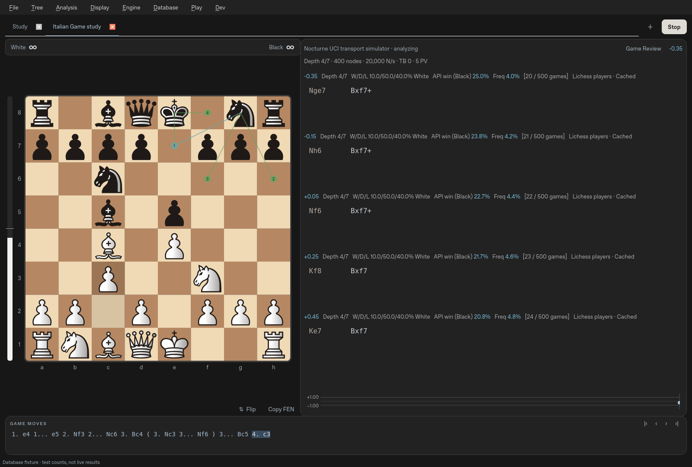

# Nocturne Analysis · 0.5.7.21

A native, offline Windows chess analysis GUI inspired by Nibbler. You supply
Stockfish or another UCI executable. **The desktop app has no built-in engine.**

The 0.5 direction replaces the earlier custom-engine product. Historical engine
source/tests remain for reproducibility; they are excluded from the desktop bundle.



*This screenshot uses the protocol test simulator, not Stockfish or measured chess
analysis. The simulator is not bundled in the application. Database counts in this capture
are explicitly labelled fixtures, not live results.*

**0.5.7.21: two-row MultiPV with per-line expansion.** Each candidate reserves
two move rows by default, with an arrow at the end of the second row to expand
only that candidate to its complete current engine line. Click again to collapse
it; other candidates remain compact. Expansion resets when the suggested first
move changes. The Dev menu can still expand all candidates together.
Database footers distinguish lookups that are still loading, completed
positions with no matching games, and service or connection errors.

**0.5.7.20: clearer MultiPV evaluation and depth.** The evaluation and depth
appear together above each principal variation; W/D/L, API win rate, frequency
and source information sit in a fixed footer below the reserved move lines.

**0.5.7.19: crisp Cburnett and future piece styles.** Cburnett uses the same
direct vector rendering as the Nibbler default. The renderer follows each
piece set's SVG viewBox without an extra inset; adding a licensed SVG set to the
piece registry automatically gives it the same antialiased high-DPI treatment.
All 36 pieces in the three styles are covered at 1×, 2× and 3×.
[Cburnett Qt capture](docs/cburnett-vector.png).

**0.5.7.18: sharp Nibbler-style pieces.** The default renders the matching
shaded Merida SVGs directly at device resolution instead of enlarging 240×240
PNGs. The silhouettes, gradients and padding retain the requested look on the
board, during dragging/animation, in settings, promotion icons and hover previews.
The original PNGs and source/license notices remain included.
[Light appearance with Grey board](docs/vector-studio-light.png).

**0.5.7.17: experimental small hover board.** Enable **Dev → Preview moves on a
small board near cursor**. History, database and MultiPV previews use a small
mouse-transparent board, keeping the main board at its selected position. It
copies your piece style, palette and orientation, follows the pointer and stays
inside the window/screen. Wheel previews and clicks use the frozen displayed
line; leaving, navigating, closing or disabling the option removes the preview.
The preference is remembered and starts off by default.
[Actual Qt cursor-board capture](docs/cursor-hover-preview.png), using explicitly
labelled simulator moves and fixture database counts.

**0.5.7.16: database statistics without the lower explorer panel.**
**Database → Show database explorer** only shows/hides the table. API win and
frequency continue to update in each MultiPV header, including after navigation.
Selecting Masters, Lichess players or ChessDB enables statistics without opening
the panel. **Enable database statistics** independently disables all lookups;
fresh installations still start offline. Saved database selections are retained on upgrade even with the panel hidden.
The separate statistics switch provides an explicit offline opt-out.

## Windows: download and open

The 0.5.7.21 Windows build is being validated. The latest verified build is
[Windows 0.5.7.20](https://github.com/understandingothers789-pixel/nocturne-chess/actions/runs/39161047849/artifacts/12149276470).
Extract All, then open **Nocturne/Nocturne.exe**. See the [build receipt](docs/BUILDING.md)
and [development log](PROGRESS.md).

[Previous verified Windows 0.5.7.15](https://github.com/understandingothers789-pixel/nocturne-chess/actions/runs/39107769865/artifacts/12129033459)
remains available as a fallback.

**0.5.7.15: cumulative validation fixes.** Database requests now recheck their
monotonic dispatch deadline, guarding against early Windows timer delivery.
Game Review works through the whole game with the configured **per-position**
search time; there is no 10- or 20-second total review limit. The automated
six-move integration fixture permits 20 seconds for cold startup, all searches
and saved evidence; grading/completion assertions are unchanged.

This build includes all the separately committed appearance, pieces, graph and
spacing changes below. Native validation and packaging passed.

**0.5.7.14: denser move spacing.** Game history uses single spaces and tighter
line/panel spacing. Analysis keeps its text size and padded equal-width SAN
slots, with smaller gaps and modestly tighter rows—typically one or two extra columns,
depending on window width and DPI.
Three fixed PV rows, hover snapshots, colors and wheel navigation remain.
[Compact light appearance](docs/compact-studio-light.png).

This cumulative build includes the exact Nibbler pieces, blue API metrics,
10% last-move shading and dotted/compressed graph from separate commits.
The cumulative Windows 0.5.7.15 download above includes this spacing change.

**0.5.7.13: evaluation graph reference guides.** Dotted +1.00/−1.00 lines mark
one-pawn advantages, with a subtle equality baseline and labelled scale. Near
zero the vertical scale is linear; beyond ±1 pawn it compresses logarithmically.
The range expands smoothly to fit real samples with headroom. Mate sentinels sit
at the edges without flattening normal scores. Raw evaluations and hover values
remain unchanged. Graph zoom, middle-drag pan and click navigation are retained.

This is a separate version-labelled graph commit, following the pieces commit.
Validated in the cumulative 0.5.7.15 build; earlier changes remain included.

**0.5.7.12: the exact Nibbler piece set is now the default.** All twelve original
240×240 transparent PNGs are included, including the Black bishop and king needed
to complete the reference set. Board, drag animations, settings preview
and promotion choices use the same artwork. The upgrade selects Nibbler once;
later saved Cburnett/Original choices are respected. Choose in **Display → Board
appearance… → Piece style**; live preview and Cancel/Save still work.

This version also includes the blue evaluation/API/frequency headers and **10%**
last-move shading below. [Light appearance](docs/nibbler-pieces-light.png).
The cumulative Windows 0.5.7.15 download above includes this piece set.
Artwork sources/licenses: [Nibbler/Merida notice](licenses/NIBBLER-PIECES-NOTICE.txt).

**0.5.7.11: Nibbler-inspired analysis metrics.** Each suggested-line header now
uses blue for evaluation, API win percentage and move frequency; depth, W/D/L,
sample counts and source details remain neutral. Headers use the available width
and wrap with identical reserved heights, preserving hovered PV placements.

Enable a source under **Database** for statistics. **API win** is the actual win
percentage for the side to move after that candidate (draws remain in the sample,
not counted as half wins). **Freq** is the move's games divided by all games for
the position and selected database filters, not just the returned moves. Headers
show the move/position sample counts, source, and live/cached status. Missing data
shows a dash. ChessDB has a separate **DB White** score and no fabricated win or
frequency percentages. Engine W/D/L remains explicitly from White's perspective.

Last-move square shading is now **10%** brighter/darker, retaining each square's
own hue/saturation. Existing piece colors, thin hints and wheel controls remain.

The metrics-only 0.5.7.11 native build passed both full runs (167 passed/5 optional
skips each). The latest cumulative download above also includes the later changes.
[Light appearance with test statistics](docs/analysis-metrics-light.png).

**0.5.7.10: softer colors and wheel navigation.** White analysis moves use muted
ivory; Black moves a slightly darker warm tint. Saved game moves use soft blue.
Metadata uses restrained blue-gray instead of bright white. Candidate rods and
number circles are thinner/smaller. Last-move squares retain their own palette
hue/saturation with only a five-point HSV brightness shift, rather than yellow.

**Display → Wheel navigates game moves** enables previous/next navigation over
the board or Game Moves. **Display → Wheel previews analysis moves** steps through
the suggested line under the pointer without editing the game. Up goes backward,
down forward; leaving the line restores the real position. Both are on by default
and remembered. Hold **Shift** for normal scrolling. Trackpad deltas accumulate
into individual moves. Analysis previews freeze their displayed line until you leave.

[Download Windows 0.5.7.10](https://github.com/understandingothers789-pixel/nocturne-chess/actions/runs/39101008893/artifacts/12126636588).
Extract All, then open **Nocturne/Nocturne.exe**. Both native runs passed
164 tests with 5 optional skips; Ruff and both packaged launch checks passed.
Prior verified downloads remain below.
[Light appearance](docs/quiet-studio-light.png).

**0.5.7.9: easier-to-hit, aligned analysis moves.** Each suggested move uses an
identical padded slot, so `e4` and `Qxe4` occupy the same width. Three reserved
rows remain the default. **Dev → Expand analysis beyond three rows** lets each
candidate grow to show its entire engine line; this preference is remembered.
Board markers and subtle White/Black text colors are unchanged.

[Download Windows 0.5.7.9](https://github.com/understandingothers789-pixel/nocturne-chess/actions/runs/39100427444/artifacts/12126700388).
Extract All, then open **Nocturne/Nocturne.exe**. Both native suites passed
160 tests with 5 optional skips; Ruff and both frozen launch checks passed.
[Expanded-layout capture](docs/expanded-analysis.png).

The verified prior build is below.

**0.5.7.8: quieter analysis text.** The analysis panel has no numbered badges or
rank colors. Headings are neutral gray, and White/Black move text differs only
by a very subtle gray tint. The board's teal/green lines and numbered circles
are retained, along with stable three-line PV slots and hover previews.

[Download Windows 0.5.7.8](https://github.com/understandingothers789-pixel/nocturne-chess/actions/runs/39099441736/artifacts/12124934909).
Both native test runs passed 158 tests with 5 optional skips; packaged GUI/UCI
launch checks passed. [Light-mode capture](docs/subtle-analysis-light.png).
The earlier three builds below remain available as fallbacks.

**Download 3 · 0.5.7.7 includes all three changes.**
The bottom Game Moves strip shows move numbers and SAN, with variations and hover
navigation. Clock tags, comments and review metadata remain in saved/exported PGNs.
**Dev → Show raw PGN data** opens a separate read-only tab; it starts off by default.

| Windows download | Includes |
| --- | --- |
| [1 · 0.5.7.5](https://github.com/understandingothers789-pixel/nocturne-chess/actions/runs/39097285528/artifacts/12125655113) | Live settings previews |
| [2 · 0.5.7.6](https://github.com/understandingothers789-pixel/nocturne-chess/actions/runs/39097588959/artifacts/12125422408) | Previews + teal/green MultiPV |
| [3 · 0.5.7.7](https://github.com/understandingothers789-pixel/nocturne-chess/actions/runs/39098023371/artifacts/12125303892) | All above + clean moves and optional raw PGN |

All three builds passed native Windows tests twice and packaged launch checks.
GitHub sign-in is required. These are three cumulative source commits and three
separate builds. The latest passed 158 tests with 5 optional skips in each run.


**Download 2 · 0.5.7.6: reference-style MultiPV markers.**
The leading candidate uses teal, alternatives use green, and numbered circles
sit at the move destinations on thin connecting lines. Matching circle badges
and move colors connect board suggestions to the reserved MultiPV rows. Candidate
clicks keep choosing the highest-ranked move when destinations overlap.


**Download 1 · 0.5.7.5: live Studio appearance previews.**
Changing board palette, piece style, light/dark appearance, coordinates or overlays
previews immediately in the dialog and on your board. Save keeps the choices;
Cancel or closing the dialog restores the prior appearance. This older version
used Cburnett by default; 0.5.7.12 defaults to Nibbler, with Cburnett and Original
retained as optional styles.


**0.5.7.4 shows clocks recorded in imported PGNs.**
The Display → Clocks option updates the board clock strip. Raw `[%clk]` and
`[%timestamp]` tags are kept in exported PGNs and the optional raw view, while
the Game Moves component shows moves only. Clock values follow the
selected variation. The previous 0.5.7.3 neutral interface, classic board colors,
and persistent clock toggle remain.
The default board is classic brown and cream, with a Grey option under
**Display → Board appearance… → Board palette**. Dark mode uses charcoal panels;
light mode uses neutral whites/greys. Move text, graphs, menus, highlights and the
application icon use the same neutral styling. The working Cburnett pieces and
fixed three-line MultiPV behavior are retained.
The previously verified 0.5.7.3 download is retained below as a fallback.
These remain unsigned developer builds; acceptance by the user's Windows setup
must be checked on that computer.

The three downloads above remain available separately for comparison and fallback.
The versioned workflow runs native tests and frozen GUI/UCI smoke checks before upload.
Extract the entire ZIP, open **Nocturne**, and double-click **Nocturne.exe**.
Keep its `_internal` folder beside the executable. Python is not required.
These are unsigned test builds; no batch/PowerShell launcher or security-policy
change is provided. The ZIP also includes the corresponding source archive.

[Working Windows 0.5.7.3 download](https://github.com/understandingothers789-pixel/nocturne-chess/actions/runs/39095336406/artifacts/12124810527) — retained as a fallback.

## Appearance and clocks

**Display → Clocks** shows/hides the clock portion and saves your choice. Analysis
has a compact White/Black strip above the board; Play uses the existing player
clocks. Hiding the display does not pause/reset a timed game or change its
position. Set a time control and increment through **File → New game…** in a
playing mode. Analysis pauses the game clocks; untimed games show ∞. Returning
to a saved game retains its time control and remaining times. Imported PGN clock
annotations (`[%clk]`) show the recorded time in the board clock strip at the selected position;
positions with no recorded value show an em dash.


On upgrade, the old Forest default changes to Classic once. Other saved board
choices are retained; subsequent selections remain yours. Choose **Grey** for a
traditional grey board, or switch **Display → Light appearance** for a neutral
light interface. Older board palettes remain available as explicit choices.

## Your saved PGNs

Every save also writes a complete PGN in the **PGNs** folder beside the local
SQLite library. Copies include variations, comments and evaluation annotations.
Each study keeps its own file; starting/importing another game preserves previous
PGNs. Autosaves run every 15 seconds and at study changes/close. Repeated saves
update that study's file atomically and leave an unchanged PGN untouched.

Use **File → Saved PGNs / game library…** to reopen prior games, or **File → Open
saved PGN folder** to see the files in Windows Explorer. The folder lives in your
per-user Nocturne data directory, so keep it when upgrading the application.
Earlier library games are exported in the background on startup, without changing
your resume game. Corrupt library records are reported and retained. If a PGN
write fails, the SQLite save remains available and the status bar reports it.
Imported clock/timestamp comments are retained in PGNs. Live running-clock state
and engine profile settings remain in the library. The bottom Game Moves strip
keeps this metadata hidden; Dev → Show raw PGN data reveals the full read-only PGN.


## Connect your Stockfish

1. **Engine → Choose engine… → Add executable…**. Select your existing engine.
2. Wait for the reported engine name/options, choose a profile name, then **OK**.
3. Use **Engine → MultiPV** to select analysis lines (presets or Custom). This
   works in both **Engine → Analysis limits → Continuous** and **Bounded**.
   **Set limits…** configures bounded depth/time/nodes. The display supports up to
   32 PVs, within the engine's advertised range.
4. **Analysis → Go/Halt** starts/stops analysis. Moving or navigating restarts the
   search on the new position while retaining the engine process/hash allocation.

**Engine → Threads**, **Hash**, and **MultiPV** contain the configuration controls.
Threads/Hash provide checked presets, custom values and engine defaults. Hash labels switch to GB at 1,024 MB
(1 GB); the Threads menu includes 14 when supported. Custom Hash input remains
in exact MB, with its conversion shown. Settings stay in the top Engine menu,
leaving the right pane for analysis. Threads/Hash save per engine profile;
MultiPV saves as an analysis preference. **Active engine** switches profiles. “Applied to engine” appears only after the engine acknowledges
its ready barrier; stopped analysis stays stopped when you change a setting.
During live analysis, changes stop the old search, apply settings, then resume on
the same process. Unsupported options are marked unavailable. Hash choices respect
both the engine's range and the current memory budget, accounting for an existing
hash allocation when resizing. A larger hash or more threads is not automatically
faster or stronger; benchmark your engine and hardware. Saved scores retain the
originating profile and acknowledged UCI settings, including resource defaults.


Stockfish versions are not hardcoded. Options are discovered via `uci`, including
Threads, Hash, MultiPV, SyzygyPath, UCI_Chess960 and UCI_ShowWDL when advertised.
Other spin/check/string/combo/button options have a generic editor. Values respect
reported bounds; Hash also respects a conservative current memory budget. Custom
MB values are supported. Hardware presets for a Ryzen 9800X3D/32 GB are starting
points: 2 threads/256 MB, 6/1024, or 8/4096. Resource presets leave MultiPV unchanged. They are not benchmarks
or verified optima. Conventional Stockfish CPU analysis does not use the Radeon GPU.

No engine or table files are downloaded or bundled. **Choose Syzygy folder…** sends
its path to compatible engines; separate folders can be entered using `;` on Windows
in Settings or the engine's own SyzygyPath option. The external engine performs the
probes, and reported TB hits are displayed. Unsupported options are not fabricated.

## Online databases


Choose **Database → Masters database**, **Lichess players (Amateurs)**, or
**ChessDB · cloud analysis**.
The optional, resizable explorer opens beneath the engine's PV list. It follows
the live position; hovering a move previews it, and clicking inserts that move
as a variation while preserving existing continuations. Database moves are
ordered by game count, separately from engine rankings. Results show raw game
counts and a White / Draw / Black results bar, with an opening name when the
service supplies one. These are historical results, not engine scores.

**Database → Lichess game speed / rating groups** filters player games; Masters
has its own unfiltered data. The player endpoint aggregates rated Lichess games,
including strong players; “Amateurs” does not imply an exclusive strength range.
Standard chess is supported; Chess960 database lookup is explicitly unavailable.
Game lists/individual game downloads are not included in this release.

The explorer starts disabled. When enabled, it sends the current position and
chosen filters to the selected online database, including the [Lichess opening explorer](https://lichess.org/api#tag/Opening-Explorer).
Lichess now requires authentication. Use **Database → Create a Lichess access
token…**, create a personal token with no extra permissions, then paste it into
**Lichess access token…**. The masked token stays in memory for this session;
it is never written into settings, games, PGNs or cache. It is sent only to
`https://explorer.lichess.org`; cross-origin redirects cannot forward it.
**Clear session access token** removes it. Enter it again after restarting.

Close the panel with **×** or **Database → Show database explorer** to stop
requests. Engine analysis and local games work offline.

**ChessDB** uses its official JSON `queryall` API with learning disabled. It shows
known move scores and service notes, with scores oriented to White. Normal scores
are shown in pawns; large mate/tablebase encodings are labelled `DB` and retained
as raw codes, rather than guessing a mate distance. Unknown moves/positions are
explicit. These are remote analysis records, separate from local engine scores
and Lichess game statistics. Lichess speed/rating filters do not apply. A Lichess
token is never sent to ChessDB; no ChessDB login is needed.

Native HTTPS verification returned 29 legal ChessDB moves for the test opening.
Lichess confirmed its token requirement; authenticated live data still needs
verification with your own session token.


Up to 256 positions/filter combinations are cached in `opening-cache.sqlite3`
beside the game library. Cached data is fresh for 24 hours; older saved data is
clearly labelled when the network fails. Refresh requests new statistics. Requests
are debounced, limited to one active request and paced at least one second apart;
rate limits impose a cooldown of at least 60 seconds with no automatic retry loop.
Late replies cannot change a different position. Network failures never prevent
moving pieces or using the engine. Service availability and data coverage vary.

## Explore quickly

- **Backspace** (or **Tree → Delete current line**) removes the selected move and
  its continuations in Analysis. It selects the next sibling, or the previous one
  when deleting the last sibling; without a sibling it returns to the parent. For
  `1.e4 e5 (1...Nf6)`, deleting `e5` displays `Nf6`. Root cannot be deleted.
  PGN/text editing keeps normal Backspace behavior. The edited study autosaves.

- **Smart Move** is enabled by default for every displayed MultiPV candidate.
  Click a destination square to play that candidate. If several candidates end
  on the same square, the highest-ranked one wins automatically. A fifth-ranked
  destination works just like the first; no extra setting or chooser is needed.
- A selected piece takes priority. Manual promotions still offer a piece chooser;
  clicking a recommended promotion uses that exact engine move. Every execution
  checks the live position and legal moves. Alt+1/2/3 execute those candidates.
- **Display → Candidate markers** selects **Arrows · Lichess style** or
  **Lines · Nibbler style**. Markers follow the selected MultiPV count, with a
  small translucent rank marker. Thin, muted strokes and small arrowheads keep
  the pieces clear, including on compact boards. A shared square shows its highest rank. Changing
  MultiPV clears old recommendations while the new lines arrive. Analysis
  overlays and Smart Move can each be switched off independently.
- Candidate rows show actual cp/mate/bound scores, depths, nodes and engine WDL
  where supplied. Scores and WDL are oriented to White. No cp-to-probability or
  Leela policy/visit statistics are invented. The evaluation bar uses a display
  scaling curve, not a claimed win probability.
- Hover a PV/history move to preview its position. Leaving restores the live board
  without moving the analyzed position. Click a PV move to insert its prefix;
  right-click a line for **Insert line**, **Pin line**, **Copy SAN/UCI**, or
  **Analyze only this move** (`searchmoves`). Pinning freezes that row for the
  current position. Selecting MultiPV clears a move focus so the chosen count applies.
  **Analysis → Analyze all legal moves again** clears the focus.
- Changing a position invalidates every recommendation/preview. Engine stop waits
  for `bestmove` and an `isready` barrier before the next search. Diagnostics are
  available in the Engine menu; logs and output queues are bounded.

The default workspace is board left, a wide analysis pane on the right with the
graph at its foot, and game moves below. Each MultiPV rank reserves exactly two
text lines by default, even for a one-line PV, so updates do not push lower
candidates around. A per-line arrow expands just that candidate's full current PV;
the Dev menu can still expand all lines. Ranks reserve their places before results
arrive. A hovered PV keeps its displayed moves until you
leave it; the latest queued update then appears. Clicking uses the displayed
move, and navigation discards pending updates for the old position. Engine settings and per-line button bars occupy no
analysis space. The PGN tab bar appears when editing PGN and hides during analysis.
Splitters resize the panels; **Display → Analysis on the left** preserves the
previous layout. Light/dark palettes, coordinates, animations, overlay visibility,
branch arrows and compact/detailed statistics are configurable. Manual annotations
use right-click squares and right-drag arrows. Board images can be exported as PNG.

## Studies, PGN and Chess960

Paste PGN or FEN directly, edit PGN in the side tab, open files, or drop PGNs onto
the window. Multiple games open in separate study tabs and are saved to the library.
Ctrl+T opens a new tab. Rename studies from File; opening another study preserves
existing work. Up to 20 study IDs reopen; older games remain in the library.

Alternate moves preserve the original continuation. Nested branches, comments,
starting comments, NAGs, tags and standard `[%eval]` annotations round-trip.
**Tree → Edit comment / annotations…** edits the current node. Promote a line or
switch siblings using Tree. Comments containing literal `}` follow the PGN format's
restriction; do not expect a literal closing brace inside a brace comment to survive.
Single-import limits are 4 MB/20,000 nodes and 1,000 games.

**File → Set up position…** provides piece placement, erase, clear/reset, side to
move, castling and EP fields. Positions are validated before use. **New Chess960
position…** accepts a Scharnagl index 0–959. Chess960 uses rook-square UCI castling
and Shredder FEN rights; an engine must advertise UCI_Chess960 for analysis.
Rules and PGN handling use python-chess, with a small adapter for vector drawing.

Autosaves and settings use local SQLite in Qt's application data directory,
typically `%LOCALAPPDATA%/Nocturne/Nocturne Chess`. Corrupt records are reported,
not silently deleted. Back up the database while the app is closed.

## Game Review

Open **Analysis → Game Review…**, or click **Game Review** above the analysis lines.
Choose your engine, set seconds per search and click **Start review**. Reviewing is
optional and offline; it never changes the displayed board or overwrites variations.
The selected line includes its saved continuation even when you navigate backward.

The panel shows **White, Black and overall estimated accuracy**, counts of Best,
Excellent, Good, Inaccuracy, Mistake and Blunder, a progress indicator and a filter
for mistakes/inaccuracies. Click a row to see the position, suggested best move,
scores and achieved depths. **Show position before selected move** lets you try
another move using the normal branch-preserving board. Pause/resume/cancel keep
completed results. Opening the panel only displays results; Start runs the review.


*These example grades are test data, not measured chess analysis.*

Accuracy is a **Nocturne estimate**, not the Chess.com/Lichess game score or a
percentage of objectively correct moves. It uses published score/accuracy curves
and the arithmetic mean of graded moves; partial reviews show their coverage and
provisional percentages. Each alternative is compared by a separate root
`searchmoves` search with the same depth/time/node limits. Different achieved
depths and engine estimates can change the result. Bound scores or wrong targeted
moves pause review rather than produce a grade. Mate outcomes are treated separately
from centipawns; mate distance is not graded. Full method and sources:
[docs/REVIEW.md](docs/REVIEW.md).

Results and engine evidence persist in the local library. PGN export includes
labels, accuracy estimates and evaluation annotations; PGN reimport retains these
as comments, but cannot recover full search evidence, so rerun review for a fresh
summary. Old cp-only reviews also need rerunning for the new accuracy metric.

**Analysis → Analyze entire line… (F12)** opens the same review with a time-budget
prompt. Bounded depth/node limits and Engine-menu Threads/Hash apply. Review uses
one PV per search without changing your normal MultiPV preference. **Back to
analysis** returns to the spacious analysis view; Go starts continuous analysis.
The graph uses White's perspective: click a sample to navigate, hover for its value,
wheel to zoom, middle-drag to pan, and double-click to reset the view.

**Ctrl+K** opens searchable commands. **Display → Keyboard shortcuts…** remaps
commands with duplicate-key conflict checking and JSON import/export.

## Build and validation

Python 3.12+, native PySide6; no browser or compiler is needed for source installation:

```sh
py -3.12 -m venv .venv
.venv\Scripts\python.exe -m pip install -r requirements-dev.txt
.venv\Scripts\python.exe -m pip install --no-deps --no-build-isolation -e .
.venv\Scripts\python.exe -m nocturne
```

Use the virtual environment's Python for these commands. [Windows build instructions](docs/BUILDING.md)
produce the windowed executable with PyInstaller. Runtime works offline after installation.

Executed validation is recorded in [PROGRESS.md](PROGRESS.md). The external protocol
simulator tests startup, advertised options, MultiPV, bounds, process reuse, stale
output, crash/timeout recovery, Smart Move, review and PGN export. It is not a
playing engine. Real Stockfish 19/development builds were not installed here, so
that real-engine verification remains outstanding; no strength or speed claim is made.

## Remaining work and comparison

[Nibbler research and comparison](docs/NIBBLER_RESEARCH.md) ·
[Acceptance checklist](docs/ANALYSIS_ROADMAP.md) · [Architecture](docs/ARCHITECTURE.md).

This is a usable analysis release, not a claim of full Nibbler parity. Remaining:
independent second-engine/split-board comparison; persistent cross-study analysis
cache/snapshots; rich tree collapse/search/bookmarks/delete/restore; study collections;
figurines and additional piece sets; WDL graph/scaling controls; arbitrary saved panel
layouts; calibrated/adaptive game review. Review pause state survives in-session;
completed evidence survives restart, but an active queue is not resumed automatically.
Each tab retains its study; only the selected tab is actively analyzed. Play/self-play
currently use the selected single engine profile. Full manual Windows interaction,
DPI/suspend behavior and actual Stockfish/large Syzygy collections remain unverified.

## Licenses

The combined analysis application is **GPL-3.0-or-later** because it uses
python-chess. See [COPYING](COPYING). Original Nocturne code/assets retain their
MIT grant in [LICENSE](LICENSE). Nibbler/Merida piece PNGs are included with
upstream notices and editable Merida SVGs. No Nibbler application code or Stockfish
binary is included. The source ZIP includes Nocturne source and the installed python-chess
Python source. Qt/Python and dependency details are in
[THIRD_PARTY_NOTICES.md](THIRD_PARTY_NOTICES.md).
