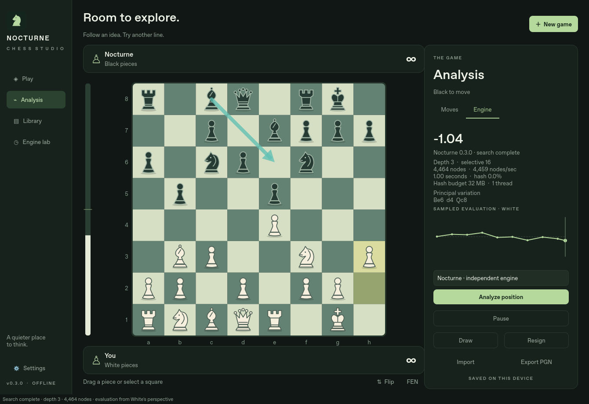

# Nocturne Analysis · 0.5.6

A native, offline Windows chess analysis GUI inspired by Nibbler. You supply
Stockfish or another UCI executable. **The desktop app has no built-in engine.**

The 0.5 direction replaces the earlier custom-engine product. Historical engine
source/tests remain for reproducibility; they are excluded from the desktop bundle.



*This screenshot uses the protocol test simulator, not Stockfish or measured chess
analysis. The simulator is not bundled in the application.*

## Windows: download and open

[Download the verified Windows 0.5.5 ZIP](https://github.com/understandingothers789-pixel/nocturne-chess/actions/runs/39070057843/artifacts/12114389477) (GitHub sign-in required).

[All Windows builds](https://github.com/understandingothers789-pixel/nocturne-chess/actions/workflows/windows.yml).
Select **Nocturne-0.5.5-Windows-x64-unsigned** under Artifacts (GitHub sign-in required).
Windows validation passed: 132 tests passed, 5 skipped; packaged app and external-UCI
protocol-fixture smoke checks passed. Real Stockfish/manual interaction verification remains open.
Extract the entire ZIP, open **Nocturne**, and double-click **Nocturne.exe**.
Keep its `_internal` folder beside the executable. Python is not required.
These are unsigned test builds; no batch/PowerShell launcher or security-policy
change is provided. The ZIP also includes the corresponding source archive.

## Your saved PGNs

Every save also writes a complete PGN in the **PGNs** folder beside the local
SQLite library. Copies include variations, comments and evaluation annotations.
Each study keeps its own file; starting/importing another game preserves previous
PGNs. Autosaves run every 15 seconds and at study changes/close. Repeated saves
update that study's file atomically and leave an unchanged PGN untouched.

Use **File → Saved PGNs / game library…** to reopen prior games, or **File → Open
saved PGN folder** to see the files in Windows Explorer. The folder lives in your
per-user Nocturne data directory, so keep it when upgrading the application.
Earlier library games are exported in the background on startup, without changing
your resume game. Corrupt library records are reported and retained. If a PGN
write fails, the SQLite save remains available and the status bar reports it.
PGNs do not contain clocks/profile settings; those remain in the library.


## Connect your Stockfish

1. **Engine → Choose engine… → Add executable…**. Select your existing engine.
2. Wait for the reported engine name/options, choose a profile name, then **OK**.
3. Use **Engine → MultiPV** to select analysis lines (presets or Custom). This
   works in both **Engine → Analysis limits → Continuous** and **Bounded**.
   **Set limits…** configures bounded depth/time/nodes. The display supports up to
   32 PVs, within the engine's advertised range.
4. **Analysis → Go/Halt** starts/stops analysis. Moving or navigating restarts the
   search on the new position while retaining the engine process/hash allocation.

**Engine → Threads**, **Hash**, and **MultiPV** contain the configuration controls.
Threads/Hash provide checked presets, custom values and engine defaults. Hash labels switch to GB at 1,024 MB
(1 GB); the Threads menu includes 14 when supported. Custom Hash input remains
in exact MB, with its conversion shown. Settings stay in the top Engine menu,
leaving the right pane for analysis. Threads/Hash save per engine profile;
MultiPV saves as an analysis preference. **Active engine** switches profiles. “Applied to engine” appears only after the engine acknowledges
its ready barrier; stopped analysis stays stopped when you change a setting.
During live analysis, changes stop the old search, apply settings, then resume on
the same process. Unsupported options are marked unavailable. Hash choices respect
both the engine's range and the current memory budget, accounting for an existing
hash allocation when resizing. A larger hash or more threads is not automatically
faster or stronger; benchmark your engine and hardware. Saved scores retain the
originating profile and acknowledged UCI settings, including resource defaults.


Stockfish versions are not hardcoded. Options are discovered via `uci`, including
Threads, Hash, MultiPV, SyzygyPath, UCI_Chess960 and UCI_ShowWDL when advertised.
Other spin/check/string/combo/button options have a generic editor. Values respect
reported bounds; Hash also respects a conservative current memory budget. Custom
MB values are supported. Hardware presets for a Ryzen 9800X3D/32 GB are starting
points: 2 threads/256 MB, 6/1024, or 8/4096. Resource presets leave MultiPV unchanged. They are not benchmarks
or verified optima. Conventional Stockfish CPU analysis does not use the Radeon GPU.

No engine or table files are downloaded or bundled. **Choose Syzygy folder…** sends
its path to compatible engines; separate folders can be entered using `;` on Windows
in Settings or the engine's own SyzygyPath option. The external engine performs the
probes, and reported TB hits are displayed. Unsupported options are not fabricated.

## Online databases


Choose **Database → Masters database**, **Lichess players (Amateurs)**, or
**ChessDB · cloud analysis**.
The optional, resizable explorer opens beneath the engine's PV list. It follows
the live position; hovering a move previews it, and clicking inserts that move
as a variation while preserving existing continuations. Database moves are
ordered by game count, separately from engine rankings. Results show raw game
counts and a White / Draw / Black results bar, with an opening name when the
service supplies one. These are historical results, not engine scores.

**Database → Lichess game speed / rating groups** filters player games; Masters
has its own unfiltered data. The player endpoint aggregates rated Lichess games,
including strong players; “Amateurs” does not imply an exclusive strength range.
Standard chess is supported; Chess960 database lookup is explicitly unavailable.
Game lists/individual game downloads are not included in this release.

The explorer starts disabled. When enabled, it sends the current position and
chosen filters to the selected online database, including the [Lichess opening explorer](https://lichess.org/api#tag/Opening-Explorer).
Lichess now requires authentication. Use **Database → Create a Lichess access
token…**, create a personal token with no extra permissions, then paste it into
**Lichess access token…**. The masked token stays in memory for this session;
it is never written into settings, games, PGNs or cache. It is sent only to
`https://explorer.lichess.org`; cross-origin redirects cannot forward it.
**Clear session access token** removes it. Enter it again after restarting.

Close the panel with **×** or **Database → Show database explorer** to stop
requests. Engine analysis and local games work offline.

**ChessDB** uses its official JSON `queryall` API with learning disabled. It shows
known move scores and service notes, with scores oriented to White. Normal scores
are shown in pawns; large mate/tablebase encodings are labelled `DB` and retained
as raw codes, rather than guessing a mate distance. Unknown moves/positions are
explicit. These are remote analysis records, separate from local engine scores
and Lichess game statistics. Lichess speed/rating filters do not apply. A Lichess
token is never sent to ChessDB; no ChessDB login is needed.

Native HTTPS verification returned 29 legal ChessDB moves for the test opening.
Lichess confirmed its token requirement; authenticated live data still needs
verification with your own session token.


Up to 256 positions/filter combinations are cached in `opening-cache.sqlite3`
beside the game library. Cached data is fresh for 24 hours; older saved data is
clearly labelled when the network fails. Refresh requests new statistics. Requests
are debounced, limited to one active request and paced at least one second apart;
rate limits impose a cooldown of at least 60 seconds with no automatic retry loop.
Late replies cannot change a different position. Network failures never prevent
moving pieces or using the engine. Service availability and data coverage vary.

## Explore quickly

- **Backspace** (or **Tree → Delete current line**) removes the selected move and
  its continuations in Analysis. It selects the next sibling, or the previous one
  when deleting the last sibling; without a sibling it returns to the parent. For
  `1.e4 e5 (1...Nf6)`, deleting `e5` displays `Nf6`. Root cannot be deleted.
  PGN/text editing keeps normal Backspace behavior. The edited study autosaves.

- **Smart Move** is enabled by default for every displayed MultiPV candidate.
  Click a destination square to play that candidate. If several candidates end
  on the same square, the highest-ranked one wins automatically. A fifth-ranked
  destination works just like the first; no extra setting or chooser is needed.
- A selected piece takes priority. Manual promotions still offer a piece chooser;
  clicking a recommended promotion uses that exact engine move. Every execution
  checks the live position and legal moves. Alt+1/2/3 execute those candidates.
- **Display → Candidate markers** selects **Arrows · Lichess style** or
  **Lines · Nibbler style**. Markers follow the selected MultiPV count, with a
  small translucent rank marker. Thin, muted strokes and small arrowheads keep
  the pieces clear, including on compact boards. A shared square shows its highest rank. Changing
  MultiPV clears old recommendations while the new lines arrive. Analysis
  overlays and Smart Move can each be switched off independently.
- Candidate rows show actual cp/mate/bound scores, depths, nodes and engine WDL
  where supplied. Scores and WDL are oriented to White. No cp-to-probability or
  Leela policy/visit statistics are invented. The evaluation bar uses a display
  scaling curve, not a claimed win probability.
- Hover a PV/history move to preview its position. Leaving restores the live board
  without moving the analyzed position. Click a PV move to insert its prefix;
  right-click a line for **Insert line**, **Pin line**, **Copy SAN/UCI**, or
  **Analyze only this move** (`searchmoves`). Pinning freezes that row for the
  current position. Selecting MultiPV clears a move focus so the chosen count applies.
  **Analysis → Analyze all legal moves again** clears the focus.
- Changing a position invalidates every recommendation/preview. Engine stop waits
  for `bestmove` and an `isready` barrier before the next search. Diagnostics are
  available in the Engine menu; logs and output queues are bounded.

The default workspace is board left, a wide analysis pane on the right with the
graph at its foot, and game moves below. PV text wraps to its full height inside
a single scrolling list. Engine settings and per-line button bars occupy no
analysis space. The PGN tab bar appears when editing PGN and hides during analysis.
Splitters resize the panels; **Display → Analysis on the left** preserves the
previous layout. Light/dark palettes, coordinates, animations, overlay visibility,
branch arrows and compact/detailed statistics are configurable. Manual annotations
use right-click squares and right-drag arrows. Board images can be exported as PNG.

## Studies, PGN and Chess960

Paste PGN or FEN directly, edit PGN in the side tab, open files, or drop PGNs onto
the window. Multiple games open in separate study tabs and are saved to the library.
Ctrl+T opens a new tab. Rename studies from File; opening another study preserves
existing work. Up to 20 study IDs reopen; older games remain in the library.

Alternate moves preserve the original continuation. Nested branches, comments,
starting comments, NAGs, tags and standard `[%eval]` annotations round-trip.
**Tree → Edit comment / annotations…** edits the current node. Promote a line or
switch siblings using Tree. Comments containing literal `}` follow the PGN format's
restriction; do not expect a literal closing brace inside a brace comment to survive.
Single-import limits are 4 MB/20,000 nodes and 1,000 games.

**File → Set up position…** provides piece placement, erase, clear/reset, side to
move, castling and EP fields. Positions are validated before use. **New Chess960
position…** accepts a Scharnagl index 0–959. Chess960 uses rook-square UCI castling
and Shredder FEN rights; an engine must advertise UCI_Chess960 for analysis.
Rules and PGN handling use python-chess, with a small adapter for vector drawing.

Autosaves and settings use local SQLite in Qt's application data directory,
typically `%LOCALAPPDATA%/Nocturne/Nocturne Chess`. Corrupt records are reported,
not silently deleted. Back up the database while the app is closed.

## Analyze a complete line

**Analysis → Analyze entire line… (F12)** uses a chosen per-position time budget
and the bounded depth/node settings. It evaluates each position and performs a
separate root `searchmoves` search for a played alternative. It does not move the
visible board. Pause/resume/cancel preserve completed results. Evaluations and
review evidence are saved with their nodes and exported as PGN annotations.

For exact centipawn scores, estimated losses of 50/100/200 cp mark inaccuracy,
mistake/blunder. Best means the engine's reported first move. Different achieved
depths are retained, so these equal-limit comparisons are estimates, not objective
proof of move quality. Mate scores are shown for inspection rather than mixed
arithmetically with centipawns. Bound scores do not become exact review labels.
The graph uses White's perspective: click a sample to navigate, hover for its value,
wheel to zoom, middle-drag to pan, and double-click to reset the view.

**Ctrl+K** opens searchable commands. **Display → Keyboard shortcuts…** remaps
commands with duplicate-key conflict checking and JSON import/export.

## Build and validation

Python 3.12+, native PySide6; no browser or compiler is needed for source installation:

```sh
py -3.12 -m venv .venv
.venv\Scripts\python.exe -m pip install -r requirements-dev.txt
.venv\Scripts\python.exe -m pip install --no-deps --no-build-isolation -e .
.venv\Scripts\python.exe -m nocturne
```

Use the virtual environment's Python for these commands. [Windows build instructions](docs/BUILDING.md)
produce the windowed executable with PyInstaller. Runtime works offline after installation.

Executed validation is recorded in [PROGRESS.md](PROGRESS.md). The external protocol
simulator tests startup, advertised options, MultiPV, bounds, process reuse, stale
output, crash/timeout recovery, Smart Move, review and PGN export. It is not a
playing engine. Real Stockfish 19/development builds were not installed here, so
that real-engine verification remains outstanding; no strength or speed claim is made.

## Remaining work and comparison

[Nibbler research and comparison](docs/NIBBLER_RESEARCH.md) ·
[Acceptance checklist](docs/ANALYSIS_ROADMAP.md) · [Architecture](docs/ARCHITECTURE.md).

This is a usable analysis release, not a claim of full Nibbler parity. Remaining:
independent second-engine/split-board comparison; persistent cross-study analysis
cache/snapshots; rich tree collapse/search/bookmarks/delete/restore; study collections;
figurines and additional piece sets; WDL graph/scaling controls; arbitrary saved panel
layouts; calibrated/adaptive game review. Review pause state survives in-session;
completed evidence survives restart, but an active queue is not resumed automatically.
Each tab retains its study; only the selected tab is actively analyzed. Play/self-play
currently use the selected single engine profile. Full manual Windows interaction,
DPI/suspend behavior and actual Stockfish/large Syzygy collections remain unverified.

## Licenses

The combined analysis application is **GPL-3.0-or-later** because it uses
python-chess. See [COPYING](COPYING). Original Nocturne code/assets retain their
MIT grant in [LICENSE](LICENSE). No Nibbler code/assets or Stockfish binary is
included. The source ZIP includes Nocturne source and the installed python-chess
Python source. Qt/Python and dependency details are in
[THIRD_PARTY_NOTICES.md](THIRD_PARTY_NOTICES.md).
