# Nocturne Analysis

A native, offline Windows chess analysis GUI inspired by Nibbler. You supply
Stockfish or another UCI executable. **Maia-3 79M is bundled for local human-move predictions.**
See [Maia controls, insights and reproducibility](docs/MAIA.md).

**Display → Arrange panels** unlocks a customizable workspace. Drag the Board,
Analysis / PGN, Game moves, Database explorer or Evaluation graph header to move
it, dock it beside another panel, stack panels as tabs, or detach it into a
separate window. Drag dividers to resize docked panels; use a detached window's
edges or corners to resize horizontally, vertically or diagonally. The board
stays square. **Done** locks your arrangement; it is saved locally and restored
locked after reopening. **Display → Reset layout** restores the classic view.
The **Classic Nibbler layout** and **Analysis on the left** presets also remain
available. Database and graph visibility still follow their existing settings.

The 0.5 direction replaces the earlier custom-engine product. Historical engine
source/tests remain for reproducibility; they are excluded from the desktop bundle.

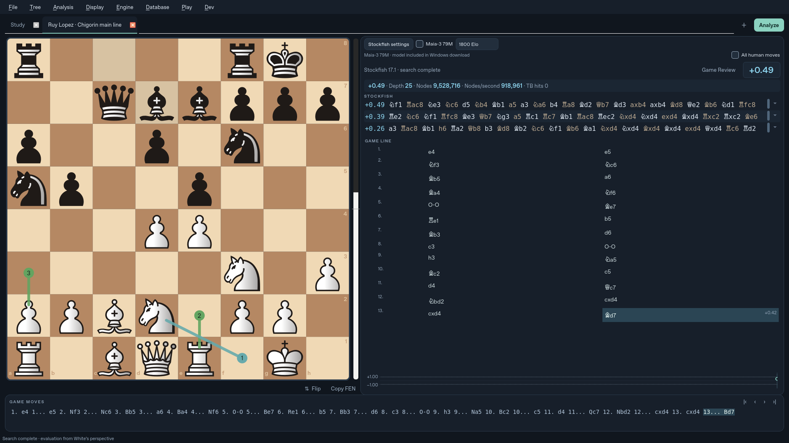

*Native Qt capture of the main line after 13...Bd7. Stockfish 17.1 NNUE reached depth 25 and reported +0.49 after 9,528,716 nodes. Maia is disabled in this capture.*


**[Download 0.5.7.116 for Windows (unsigned, x64)](https://github.com/understandingothers789-pixel/nocturne-chess/actions/runs/40775848838/artifacts/12854588788).** Matches the Maia move count to MultiPV and gives Moves by Rating space when unused candidate rows are hidden. Candidate layout updates no longer disturb active hover previews. Windows validation and packaged app/worker checks passed; artifact SHA-256: `83c8fba60f95a9688ec690ee62aa1bea7434e35c0032af9a66a2910403f07088`.

**[Download 0.5.7.115 for Windows (unsigned, x64)](https://github.com/understandingothers789-pixel/nocturne-chess/actions/runs/40755827078/artifacts/12845014018).** Applies the selected muted colors to retained Stockfish analysis: light blue for evaluations/depth, gray for White moves, and warm gray for Black moves. Windows validation passed; artifact SHA-256: `8659a618a1d423330fdf5dc5676a4acb6f5c476669794b7f258270403c7db618`.

**[Download 0.5.7.114 for Windows (unsigned, x64)](https://github.com/understandingothers789-pixel/nocturne-chess/actions/runs/40724102551/artifacts/12832323296).** Optimizes repeated Stockfish variation validation and GUI updates, loads PGN editor text on demand, caches Blunder Meter results, and defers Maia cache writes. Windows validation: 337 tests, 5 skipped; packaged app and worker checks passed.

**[Download 0.5.7.113 for Windows (unsigned, x64)](https://github.com/understandingothers789-pixel/nocturne-chess/actions/runs/40651905535/artifacts/12799569176).** Searches your selected MultiPV count and retains displaced candidates in gray with their full variations and compact depth labels. Returning candidates become live without duplicates. Windows suite: 333 tests, 5 skipped; packaged app/worker and live database checks passed.

**[Download 0.5.7.111 for Windows (unsigned, x64)](https://github.com/understandingothers789-pixel/nocturne-chess/actions/runs/40649544805/artifacts/12799532618).** Retains full candidate variations for MultiPV 1–4 and shows compact depth labels with tooltips.

**[Download 0.5.7.110 for Windows (unsigned, x64)](https://github.com/understandingothers789-pixel/nocturne-chess/actions/runs/40647988211/artifacts/12797539525).** Infers unlisted moves as blunders when an assessed blunder is present.

**[Download 0.5.7.109 for Windows (unsigned, x64)](https://github.com/understandingothers789-pixel/nocturne-chess/actions/runs/40647572147/artifacts/12797569245).** Reserves five candidate rows for MultiPV 1–4 and shows retained-line depths.

**[Download 0.5.7.107 for Windows (unsigned, x64)](https://github.com/understandingothers789-pixel/nocturne-chess/actions/runs/40646091276/artifacts/12797971562).** Keeps previous Blunder Meter results visible while new analysis loads.

**[Download 0.5.7.106 for Windows (unsigned, x64)](https://github.com/understandingothers789-pixel/nocturne-chess/actions/runs/40645754555/artifacts/12797268387).** Reclaims space when Game Moves is collapsed.

**[Download 0.5.7.105 for Windows (unsigned, x64)](https://github.com/understandingothers789-pixel/nocturne-chess/actions/runs/40644476972/artifacts/12796689265).** Prioritizes board and Stockfish updates, with secondary panels updated less often.

These GitHub Actions artifacts expire on November 27, 2026. GitHub may require you to sign in to download them. Builds 0.5.7.104 and 0.5.7.108 did not produce downloadable artifacts.

**[Download 0.5.7.103 for Windows (unsigned, x64)](https://github.com/understandingothers789-pixel/nocturne-chess/actions/runs/40642607665/artifacts/12796491839): clickable Maia destinations and less GUI work.** Click a visible Maia circle/destination to play its move, including when Stockfish or another recorded move shares that square. Manual source selection still works. Analysis updates reuse legal moves and assessments, skip unchanged meter content and avoid redundant styling/repaints. Windows validation: 326 tests, 5 skipped; packaged app/worker and live database checks passed.

**[Download 0.5.7.102 for Windows (unsigned, x64)](https://github.com/understandingothers789-pixel/nocturne-chess/actions/runs/40640944562/artifacts/12795637991): earlier best-move rows and 15 threads.** MultiPV 1–4 can fill spare rows with previous best moves, up to five displayed lines. Retained lines are gray and show their original depth after the evaluation; they support previews and copying without affecting live engine metrics. Windows validation: 318 tests, 5 skipped; packaged app/worker and live database checks passed.

**[Download 0.5.7.101 for Windows (unsigned, x64)](https://github.com/understandingothers789-pixel/nocturne-chess/actions/runs/40639680327/artifacts/12795201799): visible move-loss detail, reliable header clicks and a notes toggle.** Selected-move probability/loss text now shares the meter's compact coverage row and fits without scrolling at its default height. Collapsed Game Moves hides its stretched navigation buttons so clicks reach the header and reopen it. Display → Show Game Line notes controls note visibility while preserving stored/exported PGNs. Windows tests and packaged app/worker checks passed.

**[Download 0.5.7.100 for Windows (unsigned, x64)](https://github.com/understandingothers789-pixel/nocturne-chess/actions/runs/40636821534/artifacts/12794380955): PGN notes and compact bottom controls.** The Blunder Meter move selector now shares the percentage-strip row. Click a collapsed Game Moves strip to open it; clicking the open strip does not collapse it. Right-click a Game Line move → Edit PGN note… or press Ctrl+M: notes appear in Game Line and exports while staying hidden from the bottom strip. Idle status space and the analysis bottom margin are removed; active status messages use a compact line. Narrow analysis content now fits its viewport. Windows tests and packaged app/worker checks passed.

**[Download 0.5.7.99 for Windows (unsigned, x64)](https://github.com/understandingothers789-pixel/nocturne-chess/actions/runs/40624618214/artifacts/12788723740): alignment, labels and panel resizing fixes.** Maia percentage badges share a fixed column; rating-chart buttons and curve labels reserve room for their full move names, including long castling. Empty database results shrink downward and give space to Game Line. Collapsed Game Moves reopens by dragging its divider upward, including after Arrange/Reset Layout. Full Windows tests and packaged app/worker checks passed.

**[Download 0.5.7.98 for Windows (unsigned, x64)](https://github.com/understandingothers789-pixel/nocturne-chess/actions/runs/40619784631/artifacts/12787250940): fresh 0.95-based integration of the 0.96/0.97 layout changes.** Started from the 0.5.7.95 source integration, reapplied the revised columns, full-chart priority, compact four-column scrolling Blunder Meter, and right-side evaluation history, then built a new Windows package with version 0.5.7.98. Full Windows tests and packaged app/worker checks passed. This remains an unsigned build; the rebuild does not establish Windows signing or reputation.

**[Download 0.5.7.97 for Windows (unsigned, x64)](https://github.com/understandingothers789-pixel/nocturne-chess/actions/runs/40615829278/artifacts/12785326902): full chart visibility and a compact meter.** Stockfish and the complete rating chart/legend take priority over Blunder Meter. The meter uses four horizontal categories (Best, OK, Blunders, Not evaluated), is capped at 180px, and scrolls independently. The evaluation history graph is now the bottom section of the right column, below the database explorer. Updated defaults apply once to saved arrangements. Windows validation and packaged app/worker checks passed.

**[Download 0.5.7.96 for Windows (unsigned, x64)](https://github.com/understandingothers789-pixel/nocturne-chess/actions/runs/40612186187/artifacts/12783329678): reorganized analysis columns.** The middle column contains Stockfish/Maia analysis, Moves by Rating, then Blunder Meter. Game Line and the database explorer occupy the right column. Move Map has been removed, and the previous chart/Game Line swap option is retired. The new default replaces the old saved panel arrangement once; subsequent custom arrangements can be saved normally. Full Windows tests and packaged app/worker checks passed.

**[Download 0.5.7.95 for Windows (unsigned, x64)](https://github.com/understandingothers789-pixel/nocturne-chess/actions/runs/40596239332/artifacts/12776187578): compact Details and clearer board roles.** Maia moves shown and Calculate ratings share one row with matching field heights and a centered “to”; narrow panels stack the controls. Stockfish now uses Lichess-style arrows (blue for its best move, gray for other candidates). Maia uses numbered rods/circles only for probabilities above 10%, colored to match Moves by Rating. Circle numbers are Maia likelihood ranks. The board guide and overlay menu explain the new mapping. Full Windows tests and packaged app/worker checks passed.

**[Download 0.5.7.94 for Windows (unsigned, x64)](https://github.com/understandingothers789-pixel/nocturne-chess/actions/runs/40570617290/artifacts/12763759470): uninterrupted analysis at the node limit.** Ordinary analysis and auto-eval now start one continuous Stockfish search. Nocturne monitors the configured limit and sends Stop only after that limit has been reached and every requested variation has at least three plies, allowing shorter game-ending lines. Depth and nodes stay within the same search; the previous stop-and-research path has been removed. Window cleanup also cancels delayed callbacks and checks widget lifetime. Full Windows validation and packaged app/worker checks passed.

**[Download 0.5.7.93 for Windows (unsigned, x64)](https://github.com/understandingothers789-pixel/nocturne-chess/actions/runs/40442741272/artifacts/12707293241): complete short Stockfish variations and adjustable analysis text.** After a configured analysis limit is reached, Stockfish continues when a requested PV has fewer than three plies, until all requested lines reach three plies or a game-ending position. The continuation reuses the current engine/hash and cancels on Stop or navigation. Variation text and piece symbols start 20% larger; Display → Stockfish variation text size provides a saved 0–100% increase slider. Deferred candidate layout callbacks now cancel when their panel is destroyed. Windows tests and packaged application/worker checks passed.

**[Download 0.5.7.92 for Windows (unsigned, x64)](https://github.com/understandingothers789-pixel/nocturne-chess/actions/runs/40413308005/artifacts/12693529587): continuous previews, rating computation bounds and blue top-Maia arrow.** Stockfish row gaps and bottom PGN spaces retain previews. Details → Calculate ratings restricts foreground sweeps and GPU prefetch to saved bounds (default 600–3000). Maia’s most likely eligible move uses Lichess pale blue; the others stay gray. The board guide has an immediate hover hint and expanded explanations. The bottom divider can drag-collapse Game Moves, and the Maia row limit is a separate numeric box. All 297 Windows tests (5 skipped), packaging and worker checks passed.

**[Download 0.5.7.91 for Windows (unsigned, x64)](https://github.com/understandingothers789-pixel/nocturne-chess/actions/runs/40407442538/artifacts/12690793804): continuous variation previews and pane controls.** Stockfish move spacing now retains the preview between adjacent moves. The Maia table defaults to five rows, configurable under Details. Game Moves can collapse to a reopen strip, and a visible draggable divider resizes Stockfish against Game Line or the swapped rating chart. Full Windows tests and packaged checks passed.

**[Download 0.5.7.90 for Windows (unsigned, x64)](https://github.com/understandingothers789-pixel/nocturne-chess/actions/runs/40401079661/artifacts/12689602556): Stockfish CPU budget.** Engine → Stockfish CPU budget caps the external engine at 10%, 25%, 50% or 75% of total CPU capacity, independently of Threads. Unrestricted remains the default. Changes apply live and the choice persists. See the [CPU budget guide](docs/CPU_BUDGET.md). Full Windows tests, native job-object verification and packaged checks passed.

**[Download 0.5.7.89 for Windows (unsigned, x64)](https://github.com/understandingothers789-pixel/nocturne-chess/actions/runs/40366879677/artifacts/12670987454): Maia layout and discoverability.** Display → Swap Moves by Rating and Game Line exchanges those sections. The Maia toggle reports the loaded move count; an amber Database token row flags a missing session token. A ? beside Flip/Copy FEN explains board symbols. Engine Threads includes 3. Full Windows tests and packaged checks passed.

**[Download 0.5.7.88 for Windows (unsigned, x64)](https://github.com/understandingothers789-pixel/nocturne-chess/actions/runs/40363857280/artifacts/12670386014): Lichess-style Maia arrows.** Maia moves strictly above 10% use transparent pale-gray arrows matching the supplied Lichess SVG brush: #4a4a4a at 40% opacity, round shafts and triangular heads. Stockfish rods and numbered badges retain their style. Full Windows tests and packaged checks passed.

**[Download 0.5.7.87 for Windows (unsigned, x64)](https://github.com/understandingothers789-pixel/nocturne-chess/actions/runs/40277516019/artifacts/12630729307): compact analysis header.** All human moves and an expandable Details arrow occupy the top right. Search statistics sit beside the main evaluation; repeated evaluation text is removed. Details reveals engine, GPU and Syzygy status. Full Windows tests and packaged checks passed.

**[Download 0.5.7.86 for Windows (unsigned, x64)](https://github.com/understandingothers789-pixel/nocturne-chess/actions/runs/40275855138/artifacts/12630945556): faster analysis updates.** Maia move names are reused within a position, unchanged policy tables keep their cells, and history move numbers no longer require replaying the game. See the [performance notes](docs/audits/0.5.7.86.md).

**[Download 0.5.7.85 for Windows (unsigned, x64)](https://github.com/understandingothers789-pixel/nocturne-chess/actions/runs/40273139223/artifacts/12628584327): promote a Game Line variation from its context menu. Right-click an alternate move to make its line the mainline while keeping the previous mainline as an alternative, or promote it and delete the previous mainline.** Full Windows tests and packaged smoke checks passed. The artifact expires November 25, 2026.

**[Download 0.5.7.84 for Windows (unsigned, x64)](https://github.com/understandingothers789-pixel/nocturne-chess/actions/runs/40270943009/artifacts/12628642792): interactive saved-game preview and a compact empty explorer.** In the Saved PGNs dialog, click a move or use the mouse wheel to preview that mainline position; clicking blank space returns the board to the ending position. The preview opens at the ending position. The database explorer collapses to a small header and message when no games match. Full Windows tests and packaged smoke checks passed. The artifact expires November 25, 2026.

**[Download 0.5.7.83 for Windows (unsigned, x64)](https://github.com/understandingothers789-pixel/nocturne-chess/actions/runs/40268790525/artifacts/12627083667): calmer autosaving.** Move and analysis saves are coalesced to at most once per minute; settings save when changed. Closing the app and importing a PGN save immediately. Full Windows tests and packaged smoke checks passed. Maia is suspended during F11 self-play. The artifact expires November 25, 2026.

**[0.5.7.82](https://github.com/understandingothers789-pixel/nocturne-chess/actions/workflows/windows.yml): Maia and hardware defaults.** Maia predictions now cover 600–3000 Elo in 200-point steps, and the outcome rail shows White's expected score including half the draw rate. GPU-equipped systems default Stockfish Hash to 8 GB unless a custom value is set. The Database menu highlights a missing Lichess token after an authentication response. F11 engine self-play stops Maia inference and restores it when self-play ends.

**[0.5.7.81](https://github.com/understandingothers789-pixel/nocturne-chess/actions/runs/40263779061/artifacts/12625279239): Lichess notation throughout analysis and subtle practical-risk highlights.** Stockfish variations and Maia insight labels use Lichess piece glyphs; the bottom Game Moves PGN remains standard SAN. In the Game Line, a played blunder is softly highlighted when the position is under four pawns and Maia's green Best moves share is below 50%. Windows lint, tests, packaging and smoke checks passed.

**[0.5.7.80](https://github.com/understandingothers789-pixel/nocturne-chess/actions/runs/40260420653/artifacts/12623529006): bug fixes and performance review.** Fixes rapid Maia navigation/retry races and stale worker output. Prefetch histories are lazy, cached scanning is bounded, and background cache writes are coalesced. Unchanged preferences avoid SQLite updates; Python packages include the notation font. Full local and Windows suites and packaged checks passed. See the [audit report](docs/audits/0.5.7.80.md) for evidence and hardware limits.

**[0.5.7.79](https://github.com/understandingothers789-pixel/nocturne-chess/actions/runs/40259228794/artifacts/12624361797): GPU prefetch for the selected variation.** When Stockfish and foreground Maia are idle, the existing GPU worker fills rating sweeps and outcomes for successive positions on the selected continuation. Work runs in batches of at most two ratings, yielding between batches. Navigation and rating changes replace queued work; in-flight results are cached silently under their original position history and never overwrite current UI data. CPU inference does not prefetch. Uncached positions show calculating. Focused queue tests and Windows packaged checks passed; physical NVIDIA/AMD execution was not available in the build environment.

**[0.5.7.78](https://github.com/understandingothers789-pixel/nocturne-chess/actions/runs/40257515627/artifacts/12622829261): Lichess’s actual notation symbols.** Game Line uses the bundled Lichess/pgn4web chess notation font instead of board-piece SVGs. Glyph outlines are unchanged; only the font container and family name changed for native Qt loading. Attribution, licenses and editable font source are included. Instant board movement and variation layout are retained.

**[0.5.7.77](https://github.com/understandingothers789-pixel/nocturne-chess/actions/runs/40255877979/artifacts/12623265326): show board moves before side-panel work.** Direct board moves paint immediately without slide animation, before history rendering and persistence. Candidate rows retain their widgets across position changes to avoid layout churn, and Game Line piece icons are rendered once and reused. Move validation, saves and engine restart remain intact. In a local branching-study sample, first board paint began about 4 ms into the move handler; this is not a Windows performance guarantee.

**[0.5.7.76](https://github.com/understandingothers789-pixel/nocturne-chess/actions/runs/40254481071/artifacts/12622157517): clear vector piece icons and a Maia outcome rail.** Game Line uses high-resolution Cburnett piece shapes instead of font glyphs. A bar along the left edge of the insight cards shows Maia’s White win / draw / Black win probabilities from its actual value head, at the selected rating. The number is White’s win probability; hover for all outcomes and expected score. Predictions remain in White’s perspective on either turn.

**[0.5.7.75](https://github.com/understandingothers789-pixel/nocturne-chess/actions/runs/40251984062/artifacts/12621488272): a softer, more readable Game Line.** Chess-piece symbols replace SAN piece letters in the display, with muted teal guides, softer variation backgrounds and refined text spacing. Copied PGN retains standard notation.

**[0.5.7.74](https://github.com/understandingothers789-pixel/nocturne-chess/actions/runs/40249391355/artifacts/12619414024): compact, horizontal subvariations.** Consecutive variation moves flow across the panel and wrap naturally, with smaller text for nested branches and connected guides at forks. The main line retains paired White/Black rows and saved evaluations. Variation evaluations are available on hover; move clicking, previews and list scrolling remain available.

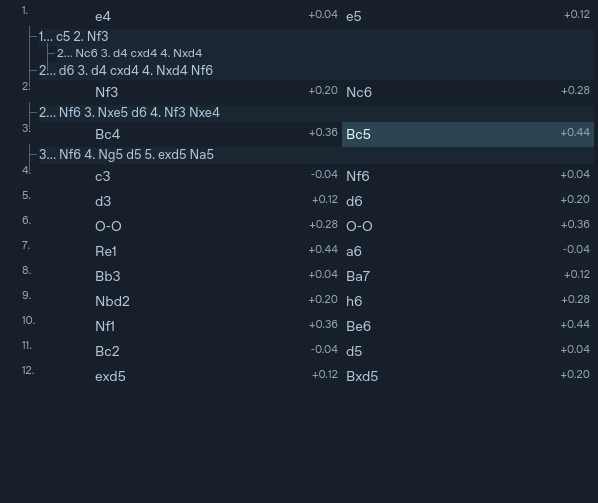

*Preview evaluations are illustrative fixtures.*

**[0.5.7.73](https://github.com/understandingothers789-pixel/nocturne-chess/actions/runs/40241682337/artifacts/12617480888): connected Game Line branches.** Continuous guide rails and short branch ticks replace repeated tree characters. Nested variations form clear groups, with move numbers in a separate gutter and saved evaluations beside the moves. Scrolling, move selection and bottom PGN notation retain their behavior.

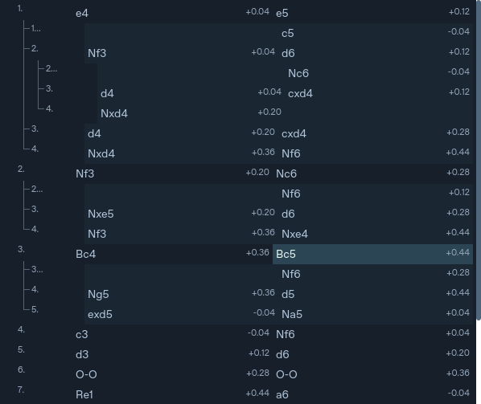

*Preview evaluations are illustrative fixtures.*

**[0.5.7.72](https://github.com/understandingothers789-pixel/nocturne-chess/actions/runs/40235451683/artifacts/12614669113): a structured, scrollable Game Line and stable analysis spacing.** Game Line uses paired White/Black move rows, saved evaluations, indented variations and a highlighted current move. Its wheel scrolls the list; board and bottom PGN scrolling retain game navigation, and the bottom PGN retains parentheses. Score refreshes are throttled and preserve the reader's scroll position. Empty positions retain blank MultiPV slots. Maia arrow tips now stop 25% inside the destination square. View the [Game Line close-up](docs/previews/structured-line-72.png) and [full UI preview](docs/previews/structured-ui-72.png); preview evaluations/policies are illustrative fixtures. Windows validation and packaged checks passed. Extract the unsigned ZIP and open `Nocturne/Nocturne.exe`.

**[0.5.7.71](https://github.com/understandingothers789-pixel/nocturne-chess/actions/runs/40231319289/artifacts/12613183048): instant placement, clear arrow tips and richer human-move previews.** All human moves now shows Move, Stockfish eval and Maia probability. Hover the Move column and scroll to step through an available Stockfish PV on a small board; unsupported moves show a brief message. Move animations default off, including old profiles. Graph-label tooltips follow their actual labels. Maia tips stop 5% inside the target square rather than at Stockfish's center badge. Cards now read 01 Moves by Rating, 02 Blunder Meter, 03 Move Map. See the [table preview](docs/previews/all-human-moves-71.png), [arrow preview](docs/previews/edge-arrows-71.png), and [practical-traps proposal](docs/PRACTICAL_TRAPS_PROPOSAL.md). Preview probabilities/evaluations are illustrative fixtures. Traps are not implemented; Move Map starts no extra searches. Windows validation and packaged checks passed. Extract the unsigned ZIP and open `Nocturne/Nocturne.exe`.

**[0.5.7.70](https://github.com/understandingothers789-pixel/nocturne-chess/actions/runs/40220827750/artifacts/12608823670): label rating curves directly and distinguish Maia arrows.** Moves by Rating now labels every visible curve on the graph, using spaced endpoint labels and connector lines for clustered probabilities. Legend buttons remain available below. Maia arrows have wider shafts, larger heads, stronger opacity and a dark outline, while Stockfish retains slim rods and numbered circles. Move Map is unchanged pending replacement ideas. View the [native UI preview](docs/previews/labels-arrows-70.png) and [five-curve label preview](docs/previews/rating-labels-70.png); all preview probabilities/evaluations are illustrative fixtures. Windows validation and packaged checks passed. Extract the unsigned ZIP and open `Nocturne/Nocturne.exe`.

**[0.5.7.69](https://github.com/understandingothers789-pixel/nocturne-chess/actions/runs/40165599725/artifacts/12587654302): cleaner Stockfish and Maia board overlays.** Stockfish candidates now use rods and numbered endpoint circles, without arrowheads. Shared moves add just the broad Maia arrow; Maia-only moves retain their arrow. Older saved Stockfish styles receive the same rendering. View the actual Qt [Italian Game preview](docs/previews/markers-italian.png) and [Queen's Gambit preview](docs/previews/markers-queens-gambit.png) before downloading. Preview evaluations, policies and curves are explicitly labelled illustrative fixtures, not measured engine analysis. Windows validation and packaged checks passed. Extract the unsigned ZIP and open `Nocturne/Nocturne.exe`.

**[0.5.7.68](https://github.com/understandingothers789-pixel/nocturne-chess/actions/runs/40163916477/artifacts/12587343828): automatic GPU setup and persistent reuse.** Maia's Auto mode starts setup automatically when its GPU runtime is missing and reuses a ready installation across launches and app updates. A failed setup is remembered to prevent repeated downloads; select Auto again to retry. CPU only skips setup. Existing working ROCm installations are reused without another download. Fresh setup still needs Python 3.12 x64 and compatible graphics drivers. Extract the unsigned ZIP and open `Nocturne/Nocturne.exe`.

**[0.5.7.67](https://github.com/understandingothers789-pixel/nocturne-chess/actions/runs/40162129568/artifacts/12587410656): optional NVIDIA CUDA and AMD ROCm acceleration.** Engine → Maia-3 79M → Inference device now offers Auto, CPU only and optional GPU setup. Setup detects NVIDIA/AMD, installs an isolated runtime, and verifies actual Maia inference before enabling it. AMD uses native ROCm 7.2.1 (supported GPU and driver 26.2.2 required), not DirectML. Setup needs Python 3.12 x64 and a potentially multi-GB download. The bundled CPU worker remains available; the status reports the active device or cached results. Physical GPU performance was not measured in CI. Extract the unsigned ZIP and open `Nocturne/Nocturne.exe`. See the [Maia GPU guide](docs/MAIA.md#optional-gpu-acceleration-05767).

**[0.5.7.66](https://github.com/understandingothers789-pixel/nocturne-chess/actions/runs/40161107406/artifacts/12586302514): clearer Moves by Rating.** Fixed unintended solid polygon fills, with transparent shading and a taller chart.

**[0.5.7.65](https://github.com/understandingothers789-pixel/nocturne-chess/actions/runs/40159206059/artifacts/12584999426): use the full analysis workspace.** Analysis and Maia panels now fill the available width, including Arrange mode.

**[0.5.7.64](https://github.com/understandingothers789-pixel/nocturne-chess/actions/runs/40139154710/artifacts/12577408803): all likely Maia moves, colored by risk.** Board arrows now show every Maia move with more than a 10% chance, using the Blunder Meter’s green/yellow/red categories. Unsearched moves remain grey, and colors update with Stockfish results. Extract the unsigned Windows ZIP and open `Nocturne/Nocturne.exe`.

**[0.5.7.63](https://github.com/understandingothers789-pixel/nocturne-chess/actions/runs/40112710365/artifacts/12567695727): drag to adjust Maia rating.** Hold the rating field and move left or right to change Maia’s rating in 200 Elo steps. Click without dragging to open the rating list. Extract the unsigned Windows ZIP and open `Nocturne/Nocturne.exe`.

**[0.5.7.62](https://github.com/understandingothers789-pixel/nocturne-chess/actions/runs/39903683180/artifacts/12480157328): a red–yellow–green Blunder Meter and a useful Move Map.** The Blunder Meter groups Maia's predicted human choices into Best moves, OK moves and Blunders, with unsearched choices in grey and their actual coverage preserved. The Move Map now plots human likelihood against Stockfish loss instead of duplicating the chessboard. Hover points for details or click to inspect a move without playing it. Extract the unsigned Windows ZIP and open `Nocturne/Nocturne.exe`. See the [Maia guide](docs/MAIA.md) and [build receipt](docs/BUILDING.md).

**[0.5.7.61](https://github.com/understandingothers789-pixel/nocturne-chess/actions/runs/39901174812/artifacts/12479113267): a clearer analysis studio.** A coordinated slate, teal and violet palette distinguishes Stockfish from Maia. Compact numbered insight cards, readable probability badges, a prominent evaluation and tighter controls improve scanning. Smaller windows keep the board useful and the Maia percentages visible; light mode receives matching contrast improvements. Extract the unsigned Windows ZIP and open `Nocturne/Nocturne.exe`. See the [build receipt](docs/BUILDING.md).

**[0.5.7.60](https://github.com/understandingothers789-pixel/nocturne-chess/actions/runs/39393552253/artifacts/12250662522): complete local Maia-3 79M integration with final mode and performance fixes.** Stockfish evaluations and PVs share rows with correctly matched Maia probabilities. The right column contains Moves by Rating, Move Map and the defined Blender Meter, with translucent Maia arrows alongside Stockfish markers. This build also prevents previous-position Maia overlays appearing in ordinary play and skips new rating sweeps while insights are hidden. The official model and CPU worker are bundled; no token or additional setup is needed. Earlier staged downloads remain below. Extract the unsigned ZIP and open `Nocturne/Nocturne.exe`. Windows tests, real-model checks and packaged smoke checks passed. See the [Maia guide](docs/MAIA.md) and [build receipt](docs/BUILDING.md).

**[0.5.7.59](https://github.com/understandingothers789-pixel/nocturne-chess/actions/runs/39392361779/artifacts/12249874525): complete Maia workspace with Blender Meter and board arrows.** The integrated Stockfish/Maia rows now sit beside exactly three insights: Moves by Rating, Move Map and Blender Meter. The meter shows both actual human likelihood and a defined relative Stockfish quality measure, with an adjustable Nocturne blend. Translucent violet Maia arrows coexist with the existing Stockfish rods and numbered circles. Display can hide insights; Engine controls rating, Maia enablement and arrow count. Existing Chess960 analysis keeps Stockfish without unsupported Maia predictions. Extract the unsigned ZIP and open `Nocturne/Nocturne.exe`. Windows tests, real-model checks and packaged smoke checks passed. See the [Maia guide](docs/MAIA.md) and [build receipt](docs/BUILDING.md).

**[0.5.7.58](https://github.com/understandingothers789-pixel/nocturne-chess/actions/runs/39391637062/artifacts/12249389717): Maia rating curves and synchronized move map.** The compact right-hand tools column adds actual 400–3000 rating predictions, clickable move legends, exact hover percentages and a selected-rating marker. A miniature move map follows the current position and rating. The existing PGN tree appears beneath the integrated analysis rows while the bottom notation strip remains available. This stage builds on .57; the Blender Meter and main-board Maia arrows arrive in .59. Extract the unsigned ZIP and open `Nocturne/Nocturne.exe`. Windows tests, real-model inference and packaged smoke checks passed. See the [build receipt](docs/BUILDING.md).

**[0.5.7.57](https://github.com/understandingothers789-pixel/nocturne-chess/actions/runs/39391107959/artifacts/12250550708): local Maia-3 79M beside Stockfish.** The Windows ZIP includes the official 79-million-parameter model and a separate CPU worker. Each Stockfish variation shows the Maia probability for that exact legal move. Select a Lichess blitz rating from 400–3000, or inspect the complete legal policy inside analysis. Predictions are cached locally; Stockfish remains independently controlled. This first stage adds the engine and integrated probabilities; later stages add the insights. Extract the unsigned ZIP and open `Nocturne/Nocturne.exe`. Windows tests, real-model checks and packaged worker smoke checks passed. See the [build receipt](docs/BUILDING.md).

**[0.5.7.56](https://github.com/understandingothers789-pixel/nocturne-chess/actions/runs/39386270667/artifacts/12247358413): fitted board and compact adjacent analysis columns.** The board container follows the square’s available height, removing oversized side margins. Analysis, database and graph stay in a compact neighboring column; spare desktop width stays on the far right for future panels. Existing two-sided dock layouts migrate, and the PGN keeps its full-width bottom row. Maia remains deferred. Extract the unsigned Windows ZIP and open `Nocturne/Nocturne.exe`. Windows tests, packaging and smoke checks passed. See the [build receipt](docs/BUILDING.md).

**[0.5.7.55](https://github.com/understandingothers789-pixel/nocturne-chess/actions/runs/39384231432/artifacts/12246168456): narrower analysis and database panel.** The entire panel now defaults to roughly half its previous width, showing around twelve compact moves per variation at typical desktop sizes. The divider remains adjustable, and full lines remain available through expansion and wheel preview. Both layout orientations stay responsive; Maia integration remains deferred. Extract the unsigned Windows ZIP and open `Nocturne/Nocturne.exe`. Windows tests, packaging and smoke checks passed. See the [build receipt](docs/BUILDING.md).

**[0.5.7.54](https://github.com/understandingothers789-pixel/nocturne-chess/actions/runs/39382171876/artifacts/12245757095): working variation arrows, compact moves and evaluations that stay visible.** Expansion arrows have a dedicated click area and expand only their own variation. Moves use natural single-space separation. Wheel browsing advances the preview board without scrolling the evaluation away; switching variations resets the old preview position, while engine updates within the same variation preserve your place. Extract the unsigned Windows ZIP and open `Nocturne/Nocturne.exe`. Windows tests, packaging and smoke checks passed. See the [build receipt](docs/BUILDING.md).

**[0.5.7.53](https://github.com/understandingothers789-pixel/nocturne-chess/actions/runs/39379180697/artifacts/12245120746): larger previews and cleaner variation rows.** The hover board is 50% larger per side and adapts to available space. Repeated depth/WDL/API detail rows are hidden by default so evaluations and moves line up closely; **Display → Detailed analysis statistics** restores them. Masters/Lichess outcome bars remain below the variations when **Database → Show database explorer** is enabled. Extract the unsigned Windows ZIP and open `Nocturne/Nocturne.exe`. Windows tests, packaging and smoke checks passed. See the [build receipt](docs/BUILDING.md).

**[0.5.7.52](https://github.com/understandingothers789-pixel/nocturne-chess/actions/runs/39376976412/artifacts/12243549117): one-line variations and small-board previews by default.** Every MultiPV candidate reserves one visible move row; its arrow expands only that variation. Hovering previews moves on the small board near your cursor and leaves the main board unchanged. Existing profiles adopt these defaults once, and later explicit choices are remembered. Toggle the cursor board in **Engine → Preview moves on a small board near cursor**. The larger redesign remains deferred. Extract the unsigned Windows ZIP and open `Nocturne/Nocturne.exe`. Windows tests, packaging and smoke checks passed. See the [build receipt](docs/BUILDING.md).

**[0.5.7.51](https://github.com/understandingothers789-pixel/nocturne-chess/actions/runs/39356660135/artifacts/12235643106): crisp game tabs and moves immediately after evaluation.** Moving tabs paint text directly instead of using Qt's cached drag bitmap. Rank numbers appear on the board's right edge in either orientation. Each variation begins with its evaluation followed immediately by its moves; depth and database details stay together below it. Focused rendering checks passed at 100%, 125% and 200% scaling; physical Windows text appearance still needs confirmation on your display. Windows tests, packaging and smoke checks passed. Extract the unsigned ZIP and open `Nocturne/Nocturne.exe`. See the [build receipt](docs/BUILDING.md).

**[0.5.7.50](https://github.com/understandingothers789-pixel/nocturne-chess/actions/runs/39355217766/artifacts/12234927567): basic engine fixes, with the redesign deferred.** The earlier interface is restored. Engine defaults remain normal **1 billion**, F12 **200 million** per position and F11 **10 million** per move, with independent reset actions. F12 shows live analysis; deliberate navigation or Escape stops automation. The larger Lichess-style redesign is saved separately. Extract the unsigned Windows ZIP and open `Nocturne/Nocturne.exe`. Windows tests, packaging and smoke checks passed. See the [release split](docs/RELEASE_SPLIT.md) and [build receipt](docs/BUILDING.md).

**[0.5.7.46](https://github.com/understandingothers789-pixel/nocturne-chess/actions/runs/39328994908/artifacts/12223857949): Copy PGN and clearer candidate copy actions.** Right-click the bottom Game Moves area to copy the current PGN. Candidate menus say **Copy SAN (this line)** and **Copy UCI (this line)**, and can copy the selected candidate as PGN. Extract the ZIP and open `Nocturne/Nocturne.exe`. See the [build receipt](docs/BUILDING.md).

**[0.5.7.45](https://github.com/understandingothers789-pixel/nocturne-chess/actions/runs/39324878577/artifacts/12222670020): normal PGN imports and clearer candidate markers.** Pasted or opened PGNs return to Engine analysis with moves in the bottom Game Moves panel. Raw PGN is hidden by default, including for older profiles; Apply PGN and Load current have explanatory tooltips. Candidate markers use thicker rods, larger numbered circles, and yellow for moves at least half a pawn below the best reported score. Endpoint numbers stay readable where rods cross. Extract the ZIP and open `Nocturne/Nocturne.exe`. See the [build receipt](docs/BUILDING.md).

**[0.5.7.44](https://github.com/understandingothers789-pixel/nocturne-chess/actions/runs/39322605181/artifacts/12221171754): subtler menus and reorderable game tabs.** The Database menu labels **Lichess Masters database (Recommended)**. Application menus use subtle alternating row shades. Drag the game tabs to change their visible order; the order is saved separately and does not alter game or PGN data. Extract the ZIP and open `Nocturne/Nocturne.exe`. See the [build receipt](docs/BUILDING.md).

**[0.5.7.43](https://github.com/understandingothers789-pixel/nocturne-chess/actions/runs/39317000462/artifacts/12217972617): draggable panels and saved layouts.** Use **Display → Arrange panels** to drag, dock, stack as tabs or detach the board, analysis/PGN tools, game moves, database and graph. Resize with dividers or floating window edges and corners; the board stays square. **Done** locks placement. Your layout survives reopening; **Display → Reset layout** restores the classic view. Windows validation and packaging passed. Extract the ZIP and open `Nocturne/Nocturne.exe`. See the [build receipt](docs/BUILDING.md).

**[0.5.7.42](https://github.com/understandingothers789-pixel/nocturne-chess/actions/runs/39312403418/artifacts/12216473704): separate cached database departures.** Masters, Lichess players and ChessDB keep their own gold move markers; hover to identify the database, including overlapping departures. Markers survive reopening a study. ChessDB distinguishes missing cloud analysis from missing games. ChessDB is selected by default without a token, and the gold tint is a little brighter with no underline. Extract the ZIP and open `Nocturne/Nocturne.exe`. See the [build receipt](docs/BUILDING.md).

**[0.5.7.40](https://github.com/understandingothers789-pixel/nocturne-chess/actions/runs/39305070431/artifacts/12213946559): preview saved games.** Hover over or select a saved PGN to see its final main-line board position and the first six full moves. Windows validation and packaging passed. Extract the ZIP and open `Nocturne/Nocturne.exe`. See the [build receipt](docs/BUILDING.md).

**[0.5.7.39](https://github.com/understandingothers789-pixel/nocturne-chess/actions/runs/39301723082/artifacts/12212705129): aligned analysis headers and a quieter book marker.** Each candidate’s score, depth, W/D/L, API win, frequency and database status share one row above its moves. The row wraps to fit the pane and keeps a consistent height across candidates. The out-of-book move uses a muted slate-blue gray tint, without bolding or an underline. Windows validation and packaging passed. Extract the ZIP and open `Nocturne/Nocturne.exe`. See the [build receipt](docs/BUILDING.md).

**[0.5.7.36](https://github.com/understandingothers789-pixel/nocturne-chess/actions/runs/39296780043/artifacts/12209442411): automatic out-of-book highlighting.** With Masters statistics enabled and a session access token in use, the first PGN move that leaves the database is marked in Game Moves. Hover it for an Out of book tooltip. Coverage runs automatically; failed requests do not count as zero games. Windows validation and packaging passed. Extract the ZIP and open `Nocturne/Nocturne.exe`. See the [build receipt](docs/BUILDING.md).

**[0.5.7.35](https://github.com/understandingothers789-pixel/nocturne-chess/actions/runs/39211281773/artifacts/12168345473): durable analysis and optional snapshots.** Reopening restores saved
analysis paused. Interrupted F12 jobs resume at the unfinished position without
repeating completed positions. **Dev → Save analysis snapshots at node milestones**
is off by default; enable it for 1M, 2M, 5M, 10M, 20M, 50M, 100M, 200M, 500M,
1B, 2B, 5B, 10B and onward. **Dev → Compare saved analysis snapshots…** compares
two checkpoints side by side. Snapshots survive reopening and disabling capture;
a fresh Analyze clears the current position's history. Windows passed 229 tests
(5 optional skips), packaging, smoke and live database checks. Extract the unsigned
ZIP and open `Nocturne/Nocturne.exe`. See the [build receipt](docs/BUILDING.md).

**[0.5.7.34](https://github.com/understandingothers789-pixel/nocturne-chess/actions/runs/39209125609/artifacts/12166893141): partial PVs, deeper review and position tools.** F12 keeps mixed-depth
and bound results at each candidate's actual depth. Suspected mistakes and
blunders get a deeper confirmation search; toggle this in **Analysis**.
**Tree → Bookmark this position… (Ctrl+B)** saves names and notes, and
**Tree → Position bookmarks** jumps to them. **Database → Find where this
line leaves the database** finds the first zero-game position and shows its
previous game count. Windows passed 224 tests (5 optional skips), packaging,
smoke and live database checks. Extract the unsigned ZIP and open
`Nocturne/Nocturne.exe`. See the [build receipt](docs/BUILDING.md) and
[implementation details and remaining ideas](docs/RECENT_COMMIT_REVIEW.md).

**[0.5.7.33](https://github.com/understandingothers789-pixel/nocturne-chess/actions/runs/39207032446/artifacts/12165844502): reviewed engine, cache and graph fixes.** F11 and F12
pause/resume from **Engine**. Normal node presets now enforce their caps and
Unlimited runs until halted. Saved MultiPV lines reload when revisiting
positions, including searches that finish with a Stockfish bound score. Graph
zoom and navigation use the same timeline, and Left-arrow rewinds resume the
main line. The Windows build passed 218 tests (5 optional skips), packaging,
smoke checks and live database checks. Extract the unsigned ZIP and open
`Nocturne/Nocturne.exe`. See the [review and five proposed improvements](docs/RECENT_COMMIT_REVIEW.md)
and [build receipt](docs/BUILDING.md).

**[0.5.7.31](https://github.com/understandingothers789-pixel/nocturne-chess/actions/runs/39198947442/artifacts/12163735077): a synced evaluation graph and separate engine node limits.** The
graph timeline follows the selected PGN position. Engine now has distinct
limits for normal analysis (1 billion nodes), auto-evaluation (200 million),
and self-play (10 million per move).

**[0.5.7.30](https://github.com/understandingothers789-pixel/nocturne-chess/actions/runs/39196589327/artifacts/12161284918): recorded move destinations and full engine details.** Smart Move
can now play the game's recorded next move by destination, even when it is
outside MultiPV. The engine status shows the full UCI name. **F11** starts
self-play from the current position (10 million nodes per move by default);
**F12** evaluates the line (200 million nodes per position). Normal analysis
defaults to 1 billion nodes. Returning from a variation to a shared main-line
position resumes the main line. Extract the unsigned ZIP and open
`Nocturne/Nocturne.exe`. See the [Windows build receipt](docs/BUILDING.md) for
validation details and the checksum.

**[0.5.7.28](https://github.com/understandingothers789-pixel/nocturne-chess/actions/runs/39191809527/artifacts/12159804179): compact analysis by default.** Expand all analysis lines is now
off by default, including for existing profiles that had an older saved value.
The global expand-all and small cursor-board preview settings are in the
**Engine** menu. Up to four candidate lines reserve three move rows, five or
more reserve two, and a candidate's arrow expands only that variation. Build
details will follow in the [Windows build receipt](docs/BUILDING.md).

**[0.5.7.26](https://github.com/understandingothers789-pixel/nocturne-chess/actions/runs/39188713970/artifacts/12158309732): evaluation-first telemetry and stable MultiPV rows.** The top
engine metrics now show the evaluation immediately before depth. With one to
four MultiPV lines selected, each compact variation stays within its three
reserved move rows as the engine updates; use that variation's arrow to reveal
its full line. Depth shows only its main value by default; use **Display → Show
selective depth (seldepth)** to include selective depth in candidate headers
and top telemetry. Extract the unsigned ZIP and launch `Nocturne/Nocturne.exe`.
See the
[build receipt](docs/BUILDING.md) for its checksum and Windows validation.

**0.5.7.25: clearer engine telemetry.** Depth shows only its main value by
default, while **Display → Show selective depth (seldepth)** reveals the
denominator. Depth, nodes and nodes per second have a restrained blue emphasis.

**0.5.7.24: steady wheel previews.** Scrolling through a candidate stays on
the selected ply while the pointer moves within the same move. Moving to a
different move switches back to hover preview. Download the unsigned
[Windows build](https://github.com/understandingothers789-pixel/nocturne-chess/actions/runs/39185429686/artifacts/12157744055)
and launch `Nocturne/Nocturne.exe` after extracting the ZIP.

**0.5.7.23: MultiPV-aware candidate rows.** One to four selected candidate
lines reserve three move rows by default; five or more reserve two. The arrow
at each row still expands only that candidate to its full engine line.

**0.5.7.22: stable wheel previews.** Scrolling through a candidate keeps the
selected ply and its current PV snapshot while the engine updates that same
root move. A new root move at that MultiPV rank resets the preview to the new
candidate.

**0.5.7.21: compact MultiPV with per-line expansion.** Each candidate reserves
two move rows by default, with an arrow at the end of the reserved rows to expand
only that candidate to its complete current engine line. Click again to collapse
it; other candidates remain compact. Expansion resets when the suggested first
move changes. The Dev menu can still expand all candidates together.
Database footers distinguish lookups that are still loading, completed
positions with no matching games, and service or connection errors.

**0.5.7.20: clearer MultiPV evaluation and depth.** The evaluation and depth
appear together above each principal variation; W/D/L, API win rate, frequency
and source information sit in a fixed footer below the reserved move lines.

**0.5.7.19: crisp Cburnett and future piece styles.** Cburnett uses the same
direct vector rendering as the Nibbler default. The renderer follows each
piece set's SVG viewBox without an extra inset; adding a licensed SVG set to the
piece registry automatically gives it the same antialiased high-DPI treatment.
All 36 pieces in the three styles are covered at 1×, 2× and 3×.
[Cburnett Qt capture](docs/cburnett-vector.png).

**0.5.7.18: sharp Nibbler-style pieces.** The default renders the matching
shaded Merida SVGs directly at device resolution instead of enlarging 240×240
PNGs. The silhouettes, gradients and padding retain the requested look on the
board, during dragging/animation, in settings, promotion icons and hover previews.
The original PNGs and source/license notices remain included.
[Light appearance with Grey board](docs/vector-studio-light.png).

**0.5.7.17: experimental small hover board.** Enable **Dev → Preview moves on a
small board near cursor**. History, database and MultiPV previews use a small
mouse-transparent board, keeping the main board at its selected position. It
copies your piece style, palette and orientation, follows the pointer and stays
inside the window/screen. Wheel previews and clicks use the frozen displayed
line; leaving, navigating, closing or disabling the option removes the preview.
The preference is remembered and starts off by default.
[Actual Qt cursor-board capture](docs/cursor-hover-preview.png), using explicitly
labelled simulator moves and fixture database counts.

**0.5.7.16: database statistics without the lower explorer panel.**
**Database → Show database explorer** only shows/hides the table. API win and
frequency continue to update in each MultiPV header, including after navigation.
Selecting Masters, Lichess players or ChessDB enables statistics without opening
the panel. **Enable database statistics** independently disables all lookups;
fresh installations still start offline. Saved database selections are retained on upgrade even with the panel hidden.
The separate statistics switch provides an explicit offline opt-out.

## Windows: download and open

Windows 0.5.7.23 build receipt and checksum: [docs/BUILDING.md](docs/BUILDING.md).
Extract All, then open **Nocturne/Nocturne.exe**. The executable is unsigned.
See the [build receipt](docs/BUILDING.md) and [development log](PROGRESS.md).

[Previous verified Windows 0.5.7.15](https://github.com/understandingothers789-pixel/nocturne-chess/actions/runs/39107769865/artifacts/12129033459)
remains available as a fallback.

**0.5.7.15: cumulative validation fixes.** Database requests now recheck their
monotonic dispatch deadline, guarding against early Windows timer delivery.
Game Review works through the whole game with the configured **per-position**
search time; there is no 10- or 20-second total review limit. The automated
six-move integration fixture permits 20 seconds for cold startup, all searches
and saved evidence; grading/completion assertions are unchanged.

This build includes all the separately committed appearance, pieces, graph and
spacing changes below. Native validation and packaging passed.

**0.5.7.14: denser move spacing.** Game history uses single spaces and tighter
line/panel spacing. Analysis keeps its text size and padded equal-width SAN
slots, with smaller gaps and modestly tighter rows—typically one or two extra columns,
depending on window width and DPI.
Three fixed PV rows, hover snapshots, colors and wheel navigation remain.
[Compact light appearance](docs/compact-studio-light.png).

This cumulative build includes the exact Nibbler pieces, blue API metrics,
10% last-move shading and dotted/compressed graph from separate commits.
The cumulative Windows 0.5.7.15 download above includes this spacing change.

**0.5.7.13: evaluation graph reference guides.** Dotted +1.00/−1.00 lines mark
one-pawn advantages, with a subtle equality baseline and labelled scale. Near
zero the vertical scale is linear; beyond ±1 pawn it compresses logarithmically.
The range expands smoothly to fit real samples with headroom. Mate sentinels sit
at the edges without flattening normal scores. Raw evaluations and hover values
remain unchanged. Graph zoom, middle-drag pan and click navigation are retained.

This is a separate version-labelled graph commit, following the pieces commit.
Validated in the cumulative 0.5.7.15 build; earlier changes remain included.

**0.5.7.12: the exact Nibbler piece set is now the default.** All twelve original
240×240 transparent PNGs are included, including the Black bishop and king needed
to complete the reference set. Board, drag animations, settings preview
and promotion choices use the same artwork. The upgrade selects Nibbler once;
later saved Cburnett/Original choices are respected. Choose in **Display → Board
appearance… → Piece style**; live preview and Cancel/Save still work.

This version also includes the blue evaluation/API/frequency headers and **10%**
last-move shading below. [Light appearance](docs/nibbler-pieces-light.png).
The cumulative Windows 0.5.7.15 download above includes this piece set.
Artwork sources/licenses: [Nibbler/Merida notice](licenses/NIBBLER-PIECES-NOTICE.txt).

**0.5.7.11: Nibbler-inspired analysis metrics.** Each suggested-line header now
uses blue for evaluation, API win percentage and move frequency; depth, W/D/L,
sample counts and source details remain neutral. Headers use the available width
and wrap with identical reserved heights, preserving hovered PV placements.

Enable a source under **Database** for statistics. **API win** is the actual win
percentage for the side to move after that candidate (draws remain in the sample,
not counted as half wins). **Freq** is the move's games divided by all games for
the position and selected database filters, not just the returned moves. Headers
show the move/position sample counts, source, and live/cached status. Missing data
shows a dash. ChessDB has a separate **DB White** score and no fabricated win or
frequency percentages. Engine W/D/L remains explicitly from White's perspective.

Last-move square shading is now **10%** brighter/darker, retaining each square's
own hue/saturation. Existing piece colors, thin hints and wheel controls remain.

The metrics-only 0.5.7.11 native build passed both full runs (167 passed/5 optional
skips each). The latest cumulative download above also includes the later changes.
[Light appearance with test statistics](docs/analysis-metrics-light.png).

**0.5.7.10: softer colors and wheel navigation.** White analysis moves use muted
ivory; Black moves a slightly darker warm tint. Saved game moves use soft blue.
Metadata uses restrained blue-gray instead of bright white. Candidate rods and
number circles are thinner/smaller. Last-move squares retain their own palette
hue/saturation with only a five-point HSV brightness shift, rather than yellow.

**Display → Wheel navigates game moves** enables previous/next navigation over
the board or Game Moves. **Display → Wheel previews analysis moves** steps through
the suggested line under the pointer without editing the game. Up goes backward,
down forward; leaving the line restores the real position. Both are on by default
and remembered. Hold **Shift** for normal scrolling. Trackpad deltas accumulate
into individual moves. Analysis previews freeze their displayed line until you leave.

[Download Windows 0.5.7.10](https://github.com/understandingothers789-pixel/nocturne-chess/actions/runs/39101008893/artifacts/12126636588).
Extract All, then open **Nocturne/Nocturne.exe**. Both native runs passed
164 tests with 5 optional skips; Ruff and both packaged launch checks passed.
Prior verified downloads remain below.
[Light appearance](docs/quiet-studio-light.png).

**0.5.7.9: easier-to-hit, aligned analysis moves.** Each suggested move uses an
identical padded slot, so `e4` and `Qxe4` occupy the same width. Three reserved
rows remain the default. **Dev → Expand analysis beyond three rows** lets each
candidate grow to show its entire engine line; this preference is remembered.
Board markers and subtle White/Black text colors are unchanged.

[Download Windows 0.5.7.9](https://github.com/understandingothers789-pixel/nocturne-chess/actions/runs/39100427444/artifacts/12126700388).
Extract All, then open **Nocturne/Nocturne.exe**. Both native suites passed
160 tests with 5 optional skips; Ruff and both frozen launch checks passed.
[Expanded-layout capture](docs/expanded-analysis.png).

The verified prior build is below.

**0.5.7.8: quieter analysis text.** The analysis panel has no numbered badges or
rank colors. Headings are neutral gray, and White/Black move text differs only
by a very subtle gray tint. The board's teal/green lines and numbered circles
are retained, along with stable three-line PV slots and hover previews.

[Download Windows 0.5.7.8](https://github.com/understandingothers789-pixel/nocturne-chess/actions/runs/39099441736/artifacts/12124934909).
Both native test runs passed 158 tests with 5 optional skips; packaged GUI/UCI
launch checks passed. [Light-mode capture](docs/subtle-analysis-light.png).
The earlier three builds below remain available as fallbacks.

**Download 3 · 0.5.7.7 includes all three changes.**
The bottom Game Moves strip shows move numbers and SAN, with variations and hover
navigation. Clock tags, comments and review metadata remain in saved/exported PGNs.
**Dev → Show raw PGN data** opens a separate read-only tab; it starts off by default.

| Windows download | Includes |
| --- | --- |
| [1 · 0.5.7.5](https://github.com/understandingothers789-pixel/nocturne-chess/actions/runs/39097285528/artifacts/12125655113) | Live settings previews |
| [2 · 0.5.7.6](https://github.com/understandingothers789-pixel/nocturne-chess/actions/runs/39097588959/artifacts/12125422408) | Previews + teal/green MultiPV |
| [3 · 0.5.7.7](https://github.com/understandingothers789-pixel/nocturne-chess/actions/runs/39098023371/artifacts/12125303892) | All above + clean moves and optional raw PGN |

All three builds passed native Windows tests twice and packaged launch checks.
GitHub sign-in is required. These are three cumulative source commits and three
separate builds. The latest passed 158 tests with 5 optional skips in each run.

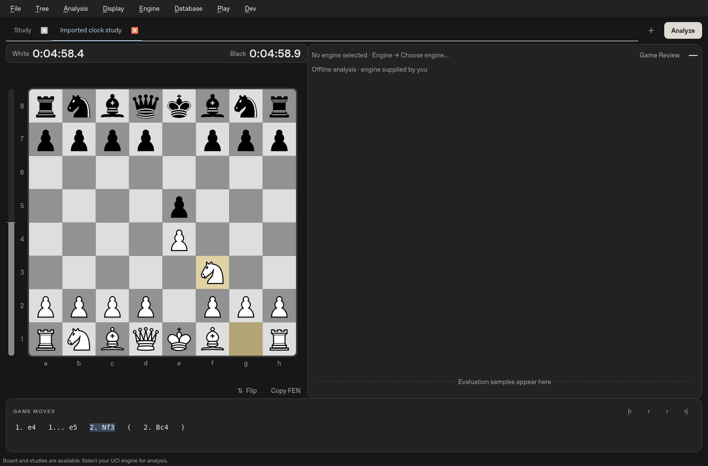

**Download 2 · 0.5.7.6: reference-style MultiPV markers.**
The leading candidate uses teal, alternatives use green, and numbered circles
sit at the move destinations on thin connecting lines. Matching circle badges
and move colors connect board suggestions to the reserved MultiPV rows. Candidate
clicks keep choosing the highest-ranked move when destinations overlap.

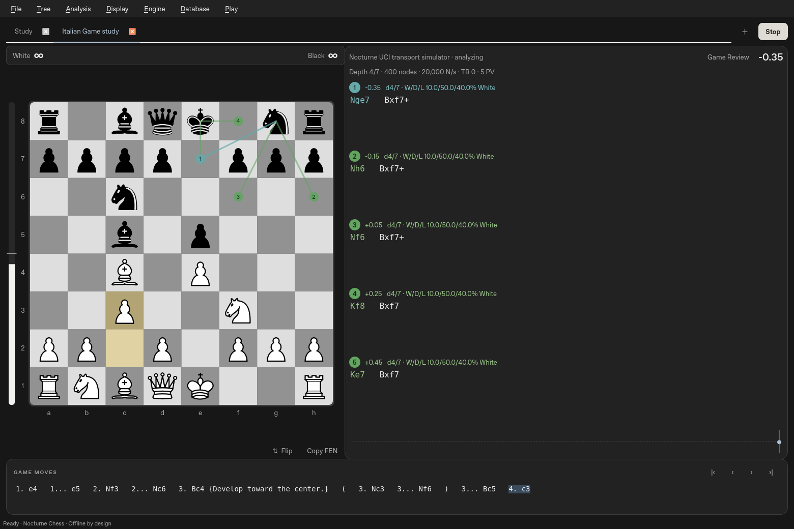

**Download 1 · 0.5.7.5: live Studio appearance previews.**
Changing board palette, piece style, light/dark appearance, coordinates or overlays
previews immediately in the dialog and on your board. Save keeps the choices;
Cancel or closing the dialog restores the prior appearance. This older version
used Cburnett by default; 0.5.7.12 defaults to Nibbler, with Cburnett and Original
retained as optional styles.

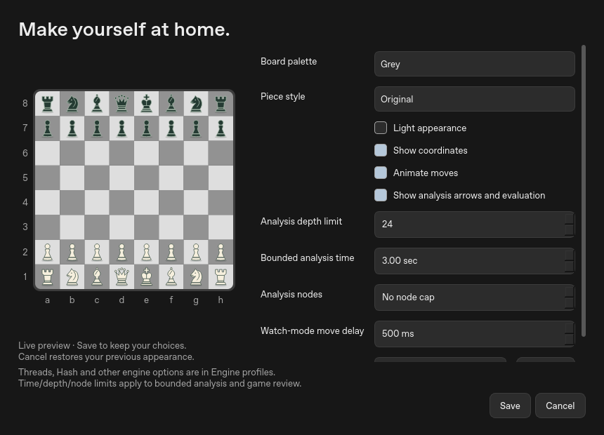

**0.5.7.4 shows clocks recorded in imported PGNs.**
The Display → Clocks option updates the board clock strip. Raw `[%clk]` and
`[%timestamp]` tags are kept in exported PGNs and the optional raw view, while
the Game Moves component shows moves only. Clock values follow the
selected variation. The previous 0.5.7.3 neutral interface, classic board colors,
and persistent clock toggle remain.
The default board is classic brown and cream, with a Grey option under
**Display → Board appearance… → Board palette**. Dark mode uses charcoal panels;
light mode uses neutral whites/greys. Move text, graphs, menus, highlights and the
application icon use the same neutral styling. The working Cburnett pieces and
fixed three-line MultiPV behavior are retained.
The previously verified 0.5.7.3 download is retained below as a fallback.
These remain unsigned developer builds; acceptance by the user's Windows setup
must be checked on that computer.

The three downloads above remain available separately for comparison and fallback.
The versioned workflow runs native tests and frozen GUI/UCI smoke checks before upload.
Extract the entire ZIP, open **Nocturne**, and double-click **Nocturne.exe**.
Keep its `_internal` folder beside the executable. Python is not required.
These are unsigned test builds; no batch/PowerShell launcher or security-policy
change is provided. The ZIP also includes the corresponding source archive.

[Working Windows 0.5.7.3 download](https://github.com/understandingothers789-pixel/nocturne-chess/actions/runs/39095336406/artifacts/12124810527) — retained as a fallback.

## Appearance and clocks

**Display → Clocks** shows/hides the clock portion and saves your choice. Analysis
has a compact White/Black strip above the board; Play uses the existing player
clocks. Hiding the display does not pause/reset a timed game or change its
position. Set a time control and increment through **File → New game…** in a
playing mode. Analysis pauses the game clocks; untimed games show ∞. Returning
to a saved game retains its time control and remaining times. Imported PGN clock
annotations (`[%clk]`) show the recorded time in the board clock strip at the selected position;
positions with no recorded value show an em dash.

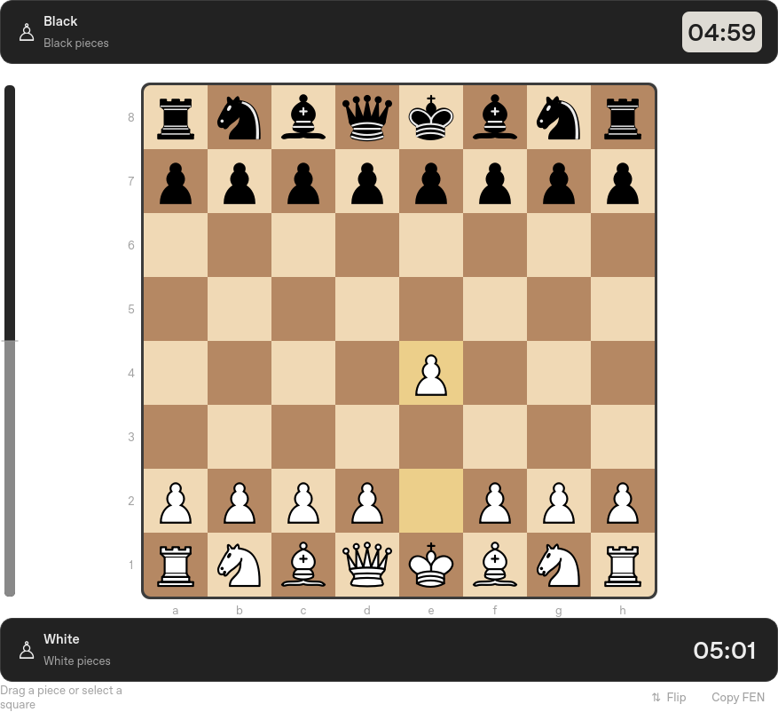

On upgrade, the old Forest default changes to Classic once. Other saved board
choices are retained; subsequent selections remain yours. Choose **Grey** for a
traditional grey board, or switch **Display → Light appearance** for a neutral
light interface. Older board palettes remain available as explicit choices.

## Your saved PGNs

Every save also writes a complete PGN in the **PGNs** folder beside the local
SQLite library. Copies include variations, comments and evaluation annotations.
Each study keeps its own file; starting/importing another game preserves previous
PGNs. Autosaves run every 15 seconds and at study changes/close. Repeated saves
update that study's file atomically and leave an unchanged PGN untouched.

Use **File → Saved PGNs / game library…** to reopen prior games, or **File → Open
saved PGN folder** to see the files in Windows Explorer. The folder lives in your
per-user Nocturne data directory, so keep it when upgrading the application.
Earlier library games are exported in the background on startup, without changing
your resume game. Corrupt library records are reported and retained. If a PGN
write fails, the SQLite save remains available and the status bar reports it.
Imported clock/timestamp comments are retained in PGNs. Live running-clock state
and engine profile settings remain in the library. The bottom Game Moves strip
keeps this metadata hidden; Dev → Show raw PGN data reveals the full read-only PGN.

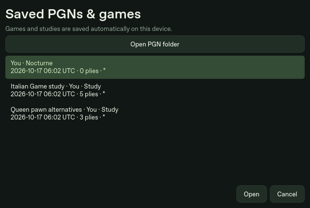

## Connect your Stockfish

1. **Engine → Choose engine… → Add executable…**. Select your existing engine.
2. Wait for the reported engine name/options, choose a profile name, then **OK**.
3. Use **Engine → MultiPV** to select analysis lines (presets or Custom). This
   works in both **Engine → Analysis limits → Continuous** and **Bounded**.
   **Set limits…** configures bounded depth/time/nodes. The display supports up to
   32 PVs, within the engine's advertised range.
4. **Analysis → Go/Halt** starts/stops analysis. Moving or navigating restarts the
   search on the new position while retaining the engine process/hash allocation.

**Engine → Threads**, **Hash**, and **MultiPV** contain the configuration controls.
Threads/Hash provide checked presets, custom values and engine defaults. Hash labels switch to GB at 1,024 MB
(1 GB); the Threads menu includes 14 when supported. Custom Hash input remains
in exact MB, with its conversion shown. Settings stay in the top Engine menu,
leaving the right pane for analysis. Threads/Hash save per engine profile;
MultiPV saves as an analysis preference. **Active engine** switches profiles. “Applied to engine” appears only after the engine acknowledges
its ready barrier; stopped analysis stays stopped when you change a setting.
During live analysis, changes stop the old search, apply settings, then resume on
the same process. Unsupported options are marked unavailable. Hash choices respect
both the engine's range and the current memory budget, accounting for an existing
hash allocation when resizing. A larger hash or more threads is not automatically
faster or stronger; benchmark your engine and hardware. Saved scores retain the
originating profile and acknowledged UCI settings, including resource defaults.

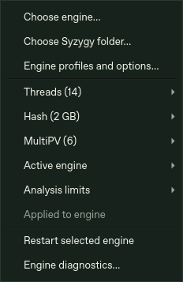

Stockfish versions are not hardcoded. Options are discovered via `uci`, including
Threads, Hash, MultiPV, SyzygyPath, UCI_Chess960 and UCI_ShowWDL when advertised.
Other spin/check/string/combo/button options have a generic editor. Values respect
reported bounds; Hash also respects a conservative current memory budget. Custom
MB values are supported. Hardware presets for a Ryzen 9800X3D/32 GB are starting
points: 2 threads/256 MB, 6/1024, or 8/4096. Resource presets leave MultiPV unchanged. They are not benchmarks
or verified optima. Conventional Stockfish CPU analysis does not use the Radeon GPU.

No engine or table files are downloaded or bundled. **Choose Syzygy folder…** sends
its path to compatible engines; separate folders can be entered using `;` on Windows
in Settings or the engine's own SyzygyPath option. The external engine performs the
probes, and reported TB hits are displayed. Unsupported options are not fabricated.

## Online databases

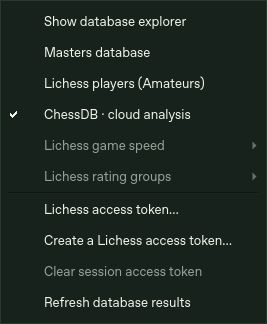


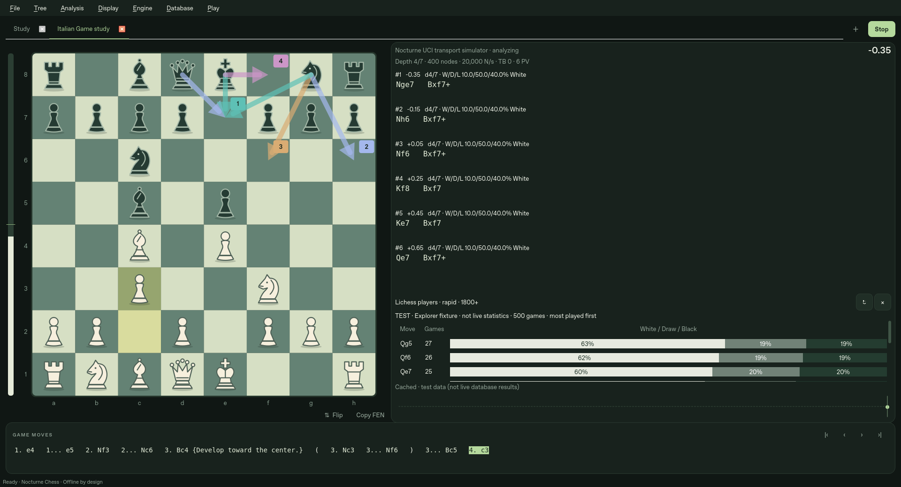


Choose **Database → Masters database**, **Lichess players (Amateurs)**, or
**ChessDB · cloud analysis**.
The optional, resizable explorer opens beneath the engine's PV list. It follows
the live position; hovering a move previews it, and clicking inserts that move
as a variation while preserving existing continuations. Database moves are
ordered by game count, separately from engine rankings. Results show raw game
counts and a White / Draw / Black results bar, with an opening name when the
service supplies one. These are historical results, not engine scores.

**Database → Lichess game speed / rating groups** filters player games; Masters
has its own unfiltered data. The player endpoint aggregates rated Lichess games,
including strong players; “Amateurs” does not imply an exclusive strength range.
Standard chess is supported; Chess960 database lookup is explicitly unavailable.
Game lists/individual game downloads are not included in this release.

The explorer starts disabled. When enabled, it sends the current position and
chosen filters to the selected online database, including the [Lichess opening explorer](https://lichess.org/api#tag/Opening-Explorer).
Without a session token, Nocturne starts with **ChessDB · cloud analysis**, which
needs no login. Entering a Lichess token switches from ChessDB to Masters;
clearing the token returns to ChessDB. Tokens are session-only, so reopening
the application selects ChessDB again. Database lookup stays off unless enabled.

With statistics enabled, coverage is checked in the selected database. Masters,
Lichess players and ChessDB save separate departure markers with the study.
Gold moves retain their source on hover, including all matching sources when
they share a departure. Lichess player filters have separate records. ChessDB
marks its first explicit `unknown` position as **No stored cloud analysis**;
this does not mean that no human has ever played the position. Checkmate,
stalemate, unscored moves and failed requests do not create departure markers.
Coverage results are cached for up to a day; the Database menu's coverage scan
can recheck a line using the position cache.

Lichess requires authentication. Use **Database → Create a Lichess access
token…**, create a personal token with no extra permissions, then paste it into
**Lichess access token…**. The masked token stays in memory for this session;
it is never written into settings, games, PGNs or cache. It is sent only to
`https://explorer.lichess.org`; cross-origin redirects cannot forward it.
**Clear session access token** removes it. Enter it again after restarting.

Close the panel with **×** or **Database → Show database explorer** to stop
requests. Engine analysis and local games work offline.

**ChessDB** uses its official JSON `queryall` API with learning disabled. It shows
known move scores and service notes, with scores oriented to White. Normal scores
are shown in pawns; large mate/tablebase encodings are labelled `DB` and retained
as raw codes, rather than guessing a mate distance. Unknown moves/positions are
explicit. These are remote analysis records, separate from local engine scores
and Lichess game statistics. Lichess speed/rating filters do not apply. A Lichess
token is never sent to ChessDB; no ChessDB login is needed.

Native HTTPS verification returned 29 legal ChessDB moves for the test opening.
Lichess confirmed its token requirement; authenticated live data still needs
verification with your own session token.

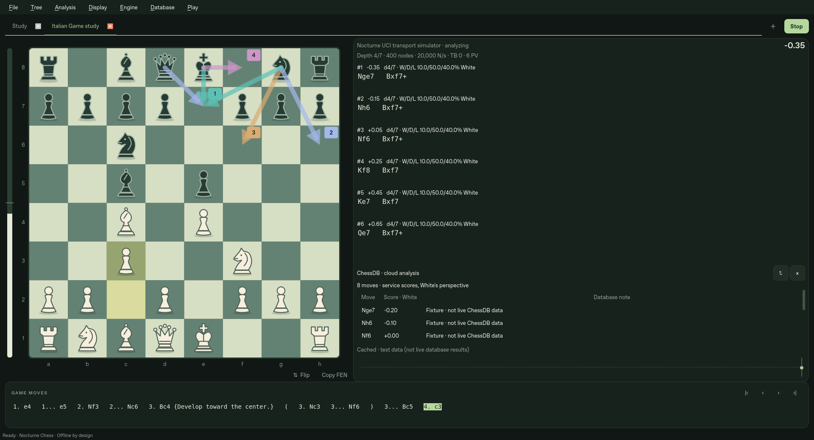

Up to 256 positions/filter combinations are cached in `opening-cache.sqlite3`
beside the game library. Cached data is fresh for 24 hours; older saved data is
clearly labelled when the network fails. Refresh requests new statistics. Requests
are debounced, limited to one active request and paced at least one second apart;
rate limits impose a cooldown of at least 60 seconds with no automatic retry loop.
Late replies cannot change a different position. Network failures never prevent
moving pieces or using the engine. Service availability and data coverage vary.

## Explore quickly

- **Backspace** (or **Tree → Delete current line**) removes the selected move and
  its continuations in Analysis. It selects the next sibling, or the previous one
  when deleting the last sibling; without a sibling it returns to the parent. For
  `1.e4 e5 (1...Nf6)`, deleting `e5` displays `Nf6`. Root cannot be deleted.
  PGN/text editing keeps normal Backspace behavior. The edited study autosaves.

- **Smart Move** is enabled by default for every displayed MultiPV candidate.
  Click a destination square to play that candidate. If several candidates end
  on the same square, the highest-ranked one wins automatically. A fifth-ranked
  destination works just like the first; no extra setting or chooser is needed.
- A selected piece takes priority. Manual promotions still offer a piece chooser;
  clicking a recommended promotion uses that exact engine move. Every execution
  checks the live position and legal moves. Alt+1/2/3 execute those candidates.
- **Display → Candidate markers** selects **Arrows · Lichess style** or
  **Lines · Nibbler style**. Markers follow the selected MultiPV count, with a
  small translucent rank marker. Thin, muted strokes and small arrowheads keep
  the pieces clear, including on compact boards. A shared square shows its highest rank. Changing
  MultiPV clears old recommendations while the new lines arrive. Analysis
  overlays and Smart Move can each be switched off independently.
- Candidate rows show actual cp/mate/bound scores, depths, nodes and engine WDL
  where supplied. Scores and WDL are oriented to White. No cp-to-probability or
  Leela policy/visit statistics are invented. The evaluation bar uses a display
  scaling curve, not a claimed win probability.
- Hover a PV/history move to preview its position. Leaving restores the live board
  without moving the analyzed position. Click a PV move to insert its prefix;
  right-click a line for **Insert line**, **Pin line**, **Copy SAN/UCI**, or
  **Analyze only this move** (`searchmoves`). Pinning freezes that row for the
  current position. Selecting MultiPV clears a move focus so the chosen count applies.
  **Analysis → Analyze all legal moves again** clears the focus.
- Changing a position invalidates every recommendation/preview. Engine stop waits
  for `bestmove` and an `isready` barrier before the next search. Diagnostics are
  available in the Engine menu; logs and output queues are bounded.

The default workspace is board left, a wide analysis pane on the right with the
graph at its foot, and game moves below. Each MultiPV rank reserves exactly two
text lines by default, even for a one-line PV, so updates do not push lower
candidates around. A per-line arrow expands just that candidate's full current PV;
the Dev menu can still expand all lines. Ranks reserve their places before results
arrive. A hovered PV keeps its displayed moves until you
leave it; the latest queued update then appears. Clicking uses the displayed
move, and navigation discards pending updates for the old position. Engine settings and per-line button bars occupy no
analysis space. The PGN tab bar appears when editing PGN and hides during analysis.
Splitters resize the panels; **Display → Analysis on the left** preserves the
previous layout. Light/dark palettes, coordinates, animations, overlay visibility,
branch arrows and compact/detailed statistics are configurable. Manual annotations
use right-click squares and right-drag arrows. Board images can be exported as PNG.

## Studies, PGN and Chess960

Paste PGN or FEN directly, edit PGN in the side tab, open files, or drop PGNs onto
the window. Multiple games open in separate study tabs and are saved to the library.
Ctrl+T opens a new tab. Rename studies from File; opening another study preserves
existing work. Up to 20 study IDs reopen; older games remain in the library.

Alternate moves preserve the original continuation. Nested branches, comments,
starting comments, NAGs, tags and standard `[%eval]` annotations round-trip.
**Tree → Edit comment / annotations…** edits the current node. Promote a line or
switch siblings using Tree. Comments containing literal `}` follow the PGN format's
restriction; do not expect a literal closing brace inside a brace comment to survive.
Single-import limits are 4 MB/20,000 nodes and 1,000 games.

**File → Set up position…** provides piece placement, erase, clear/reset, side to
move, castling and EP fields. Positions are validated before use. **New Chess960
position…** accepts a Scharnagl index 0–959. Chess960 uses rook-square UCI castling
and Shredder FEN rights; an engine must advertise UCI_Chess960 for analysis.
Rules and PGN handling use python-chess, with a small adapter for vector drawing.

Autosaves and settings use local SQLite in Qt's application data directory,
typically `%LOCALAPPDATA%/Nocturne/Nocturne Chess`. Corrupt records are reported,
not silently deleted. Back up the database while the app is closed.

## Game Review

Open **Analysis → Game Review…**, or click **Game Review** above the analysis lines.
Choose your engine, set seconds per search and click **Start review**. Reviewing is
optional and offline; it never changes the displayed board or overwrites variations.
The selected line includes its saved continuation even when you navigate backward.

The panel shows **White, Black and overall estimated accuracy**, counts of Best,
Excellent, Good, Inaccuracy, Mistake and Blunder, a progress indicator and a filter
for mistakes/inaccuracies. Click a row to see the position, suggested best move,
scores and achieved depths. **Show position before selected move** lets you try
another move using the normal branch-preserving board. Pause/resume/cancel keep
completed results. Opening the panel only displays results; Start runs the review.

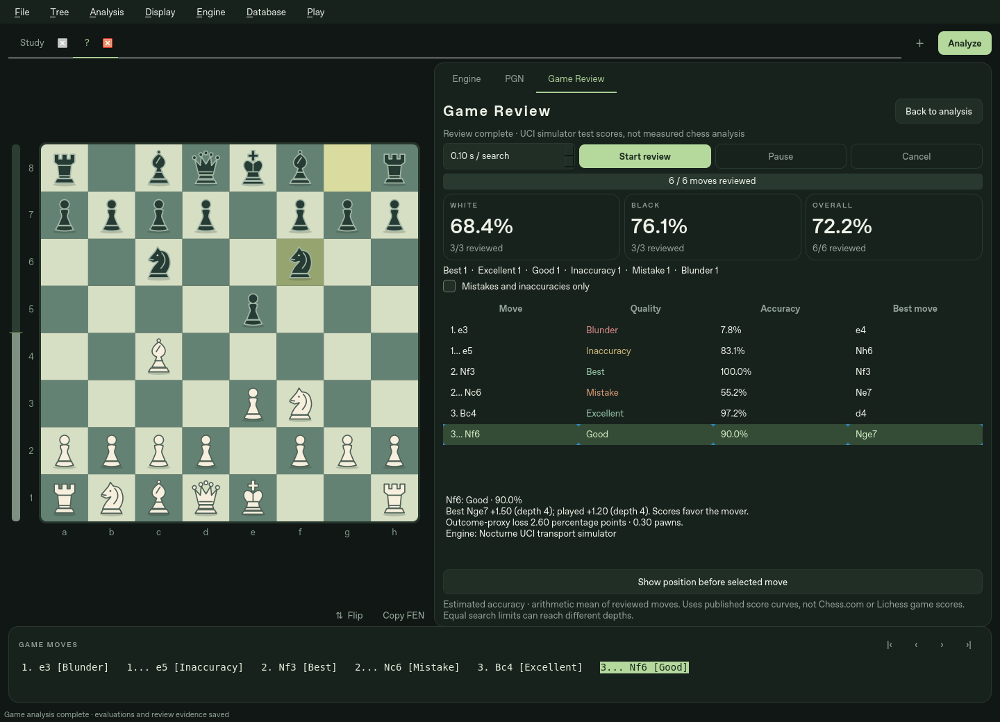

*These example grades are test data, not measured chess analysis.*

Accuracy is a **Nocturne estimate**, not the Chess.com/Lichess game score or a
percentage of objectively correct moves. It uses published score/accuracy curves
and the arithmetic mean of graded moves; partial reviews show their coverage and
provisional percentages. Each alternative is compared by a separate root
`searchmoves` search with the same depth/time/node limits. Different achieved
depths and engine estimates can change the result. Bound scores or wrong targeted
moves pause review rather than produce a grade. Mate outcomes are treated separately
from centipawns; mate distance is not graded. Full method and sources:
[docs/REVIEW.md](docs/REVIEW.md).

Results and engine evidence persist in the local library. PGN export includes
labels, accuracy estimates and evaluation annotations; PGN reimport retains these
as comments, but cannot recover full search evidence, so rerun review for a fresh
summary. Old cp-only reviews also need rerunning for the new accuracy metric.

**Analysis → Analyze entire line… (F12)** opens the same review with a time-budget
prompt. Bounded depth/node limits and Engine-menu Threads/Hash apply. Review uses
one PV per search without changing your normal MultiPV preference. **Back to
analysis** returns to the spacious analysis view; Go starts continuous analysis.
The graph uses White's perspective: click a sample to navigate, hover for its value,
wheel to zoom, middle-drag to pan, and double-click to reset the view.

**Ctrl+K** opens searchable commands. **Display → Keyboard shortcuts…** remaps
commands with duplicate-key conflict checking and JSON import/export.

## Build and validation

Python 3.12+, native PySide6; no browser or compiler is needed for source installation:

```sh
py -3.12 -m venv .venv
.venv\Scripts\python.exe -m pip install -r requirements-dev.txt
.venv\Scripts\python.exe -m pip install --no-deps --no-build-isolation -e .
.venv\Scripts\python.exe -m nocturne
```

Use the virtual environment's Python for these commands. [Windows build instructions](docs/BUILDING.md)
produce the windowed executable with PyInstaller. Runtime works offline after installation.

Executed validation is recorded in [PROGRESS.md](PROGRESS.md). The external protocol
simulator tests startup, advertised options, MultiPV, bounds, process reuse, stale
output, crash/timeout recovery, Smart Move, review and PGN export. It is not a
playing engine. Real Stockfish 19/development builds were not installed here, so
that real-engine verification remains outstanding; no strength or speed claim is made.

## Remaining work and comparison

[Nibbler research and comparison](docs/NIBBLER_RESEARCH.md) ·
[Acceptance checklist](docs/ANALYSIS_ROADMAP.md) · [Architecture](docs/ARCHITECTURE.md).

This is a usable analysis release, not a claim of full Nibbler parity. Remaining:
independent second-engine/split-board comparison; persistent cross-study analysis
cache/snapshots; rich tree collapse/search/bookmarks/delete/restore; study collections;
figurines and additional piece sets; WDL graph/scaling controls; arbitrary saved panel
layouts; calibrated/adaptive game review. Review pause state survives in-session;
completed evidence survives restart, but an active queue is not resumed automatically.
Each tab retains its study; only the selected tab is actively analyzed. Play/self-play
currently use the selected single engine profile. Full manual Windows interaction,
DPI/suspend behavior and actual Stockfish/large Syzygy collections remain unverified.

## Licenses

The combined analysis application is **GPL-3.0-or-later** because it uses
python-chess. See [COPYING](COPYING). Original Nocturne code/assets retain their
MIT grant in [LICENSE](LICENSE). Nibbler/Merida piece PNGs are included with
upstream notices and editable Merida SVGs. No Nibbler application code or Stockfish
binary is included. The source ZIP includes Nocturne source and the installed python-chess
Python source. Qt/Python and dependency details are in
[THIRD_PARTY_NOTICES.md](THIRD_PARTY_NOTICES.md).
